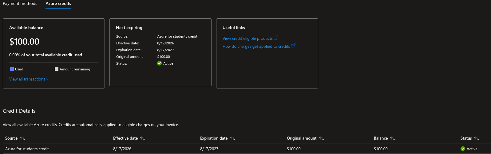
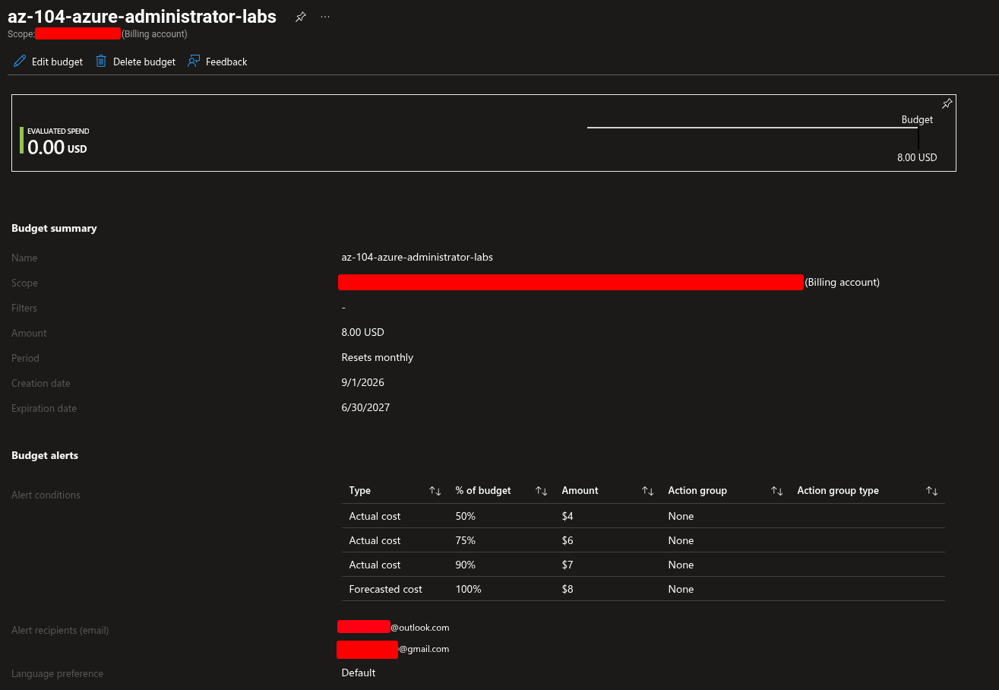
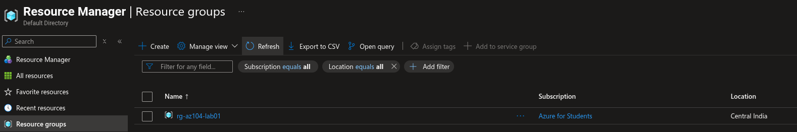
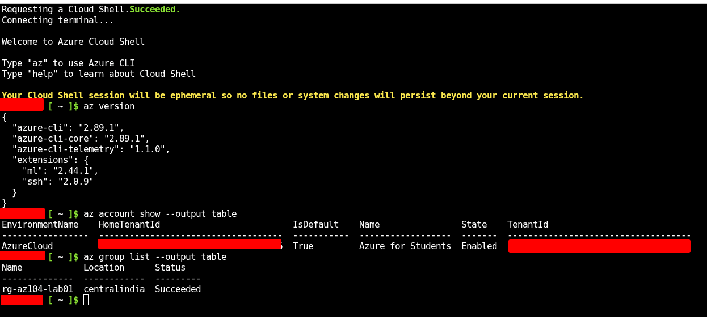
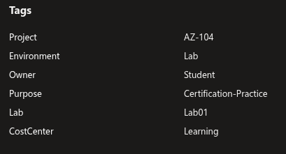

# AZ-104 Lab Environment and Cost Control

## Purpose

This directory documents the Azure environment and safety controls used for my AZ-104 hands-on labs.

## Azure Environment

- Subscription type: Azure for Students
- Primary platform: Microsoft Azure
- Primary region: Central India
- Management tools:
  - Azure portal
  - Azure CLI
  - Azure Cloud Shell
  - PowerShell
  - Git and GitHub

## Resource Naming Convention

| Resource type | Naming pattern | Example |
|---|---|---|
| Resource group | `rg-az104-lab##` | `rg-az104-lab01` |
| Virtual network | `vnet-az104-lab##` | `vnet-az104-lab01` |
| Subnet | `snet-purpose` | `snet-management` |
| Virtual machine | `vm-az104-lab##` | `vm-az104-lab01` |
| Storage account | `staz104lab##` | `staz104lab01` |
| Network security group | `nsg-az104-lab##` | `nsg-az104-lab01` |

## Standard Tags

```text
Project = AZ-104
Environment = Lab
Purpose = Certification-Practice
Owner = Student
CostCenter = Learning
```

## Cost-Control Process

- Create a separate resource group for each lab.
- Add tags to resources where supported.
- Create and monitor a Cost Management budget.
- Stop or deallocate virtual machines after use.
- Delete temporary resources immediately after verification.
- Delete complete lab resource groups when the lab is finished.
- Review Cost Management regularly.

## Cleanup Commands

```bash
az group delete \
  --name rg-az104-lab01 \
  --yes \
  --no-wait
```

Verify that the resource group has been deleted:

```bash
az group exists --name rg-az104-lab01
```

## Azure CLI Verification

```bash
az account show --output table
az group list --output table
az resource list --output table
```

## Evidence

- 
- 
- 
- 
- 

## Security Notes

No subscription IDs, tenant IDs, passwords, access keys, SAS tokens, private keys, secrets, or personal information are stored in this repository.
