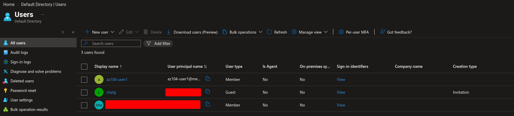
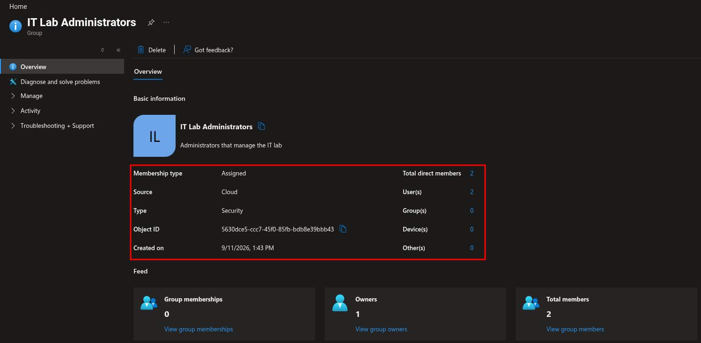

# Lab 01: Manage Microsoft Entra ID Identities

**Date:** 11 September 2026  
**Status:** ✅ Completed  
**Platform:** Microsoft Azure for Students  
**Service:** Microsoft Entra ID

## Objective

Create and configure Microsoft Entra ID user accounts, invite an external guest user, create a security group, and add users as group members.

## Tasks Completed

- [x] Reviewed the Microsoft Entra ID overview
- [x] Created the `az104-user1` user account
- [x] Configured user properties
- [x] Enabled the user account
- [x] Invited an external guest user
- [x] Created the `IT Lab Administrators` security group
- [x] Configured assigned membership
- [x] Added an owner to the group
- [x] Added users as group members
- [x] Verified the group membership
- [x] Removed temporary lab objects after verification

## User Configuration

| Setting | Value |
|---|---|
| User principal name | `az104-user1` |
| Display name | `az104-user1` |
| Account status | Enabled |
| Job title | IT Lab Administrator |
| Department | IT |
| Usage location | United States |

A temporary external guest user was also invited and added to the security group.

## Group Configuration

| Setting | Value |
|---|---|
| Group name | `IT Lab Administrators` |
| Group type | Security |
| Membership type | Assigned |
| Description | Administrators that manage the IT lab |
| Owner | Lab administrator account |
| Members | `az104-user1` and invited guest user |

## Verification

I refreshed the Microsoft Entra ID pages and verified that:

- The new user account was created successfully.
- The invited guest account appeared in the directory.
- The `IT Lab Administrators` group was created.
- The intended users appeared in the group membership list.
- The owner was displayed correctly.

## Evidence

### Created user account

### Group membership

## What I Learned

- A Microsoft Entra tenant is a dedicated identity boundary containing users, groups, applications, and directory configuration.
- A user principal name identifies a user for sign-in.
- Security groups can be used to manage access for multiple users.
- Assigned membership requires an administrator or owner to add and remove members manually.
- Guest users are external identities that can be invited into the tenant.
- User properties such as department, job title, and usage location can support identity administration and access decisions.
- Dynamic group membership depends on user or device attributes and requires the appropriate licensing.

## Job-Relevant Skills Demonstrated

- Microsoft Entra ID user administration
- External guest invitation
- Security-group management
- Assigned group membership
- Identity data management
- Access administration
- Verification and documentation
- Azure portal navigation

## Troubleshooting

No major errors occurred during this lab.

## Cleanup

- [x] Removed the temporary user account
- [x] Removed the guest invitation or guest account
- [x] Removed the temporary security group
- [x] Confirmed that no unnecessary lab resources remained

## Reflection

The main practical lesson was that identity administration is not only about creating users. It also involves organizing users into groups, managing external identities, maintaining accurate properties, and verifying that the intended membership and ownership relationships exist.
