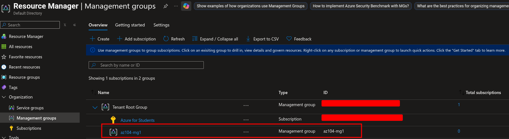
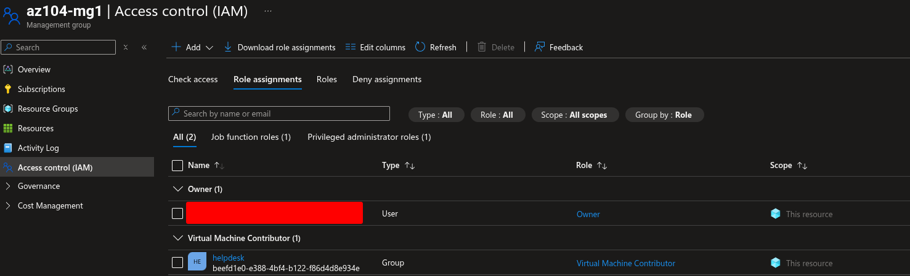
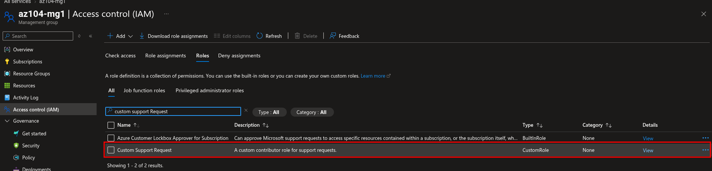
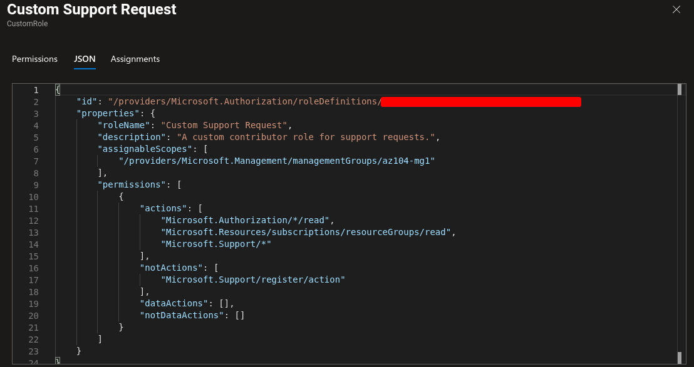
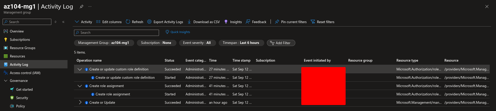

# Lab 02a: Manage Subscriptions and RBAC

**Date:** 12 September 2026  
**Status:** ✅ Completed  
**Platform:** Microsoft Azure for Students  
**Primary scope:** `az104-mg1` management group

## Objective

Create a management group, assign a built-in Azure RBAC role to a Microsoft Entra security group, create a custom RBAC role based on an existing role, and review role-related activity in the Activity Log.

## Tasks Completed

- [x] Created the `az104-mg1` management group
- [x] Reviewed Azure built-in role definitions
- [x] Created or used the `helpdesk` Microsoft Entra security group
- [x] Assigned Virtual Machine Contributor to the `helpdesk` group
- [x] Used the management group as the assignment scope
- [x] Created the `Custom Support Request` custom role
- [x] Cloned the Support Request Contributor role
- [x] Excluded the Microsoft.Support provider registration permission
- [x] Reviewed the custom role JSON
- [x] Reviewed role-related activity in Activity Log
- [x] Deleted temporary lab objects after verification

## Architecture and Scope

```text
Microsoft Entra ID
└── helpdesk security group
    └── Test user

Azure management hierarchy
└── az104-mg1 management group
    └── Virtual Machine Contributor role assignment
        └── helpdesk group
```

## Management Group

| Setting | Value |
|---|---|
| Management group ID | `az104-mg1` |
| Display name | `az104-mg1` |
| Purpose | Organize subscriptions and provide an inheritance scope for Azure RBAC and Azure Policy |

## Built-in Role Assignment

| Setting | Value |
|---|---|
| Principal | `helpdesk` security group |
| Role | Virtual Machine Contributor |
| Scope | `az104-mg1` management group |
| Assignment type | Eligible |
| Purpose | Allow Help Desk staff to manage virtual machines without granting unrelated permissions |

The role was assigned to a group rather than an individual user. Group-based assignment makes access easier to review, maintain, and audit when team membership changes.

## Custom Role

| Setting | Value |
|---|---|
| Role name | `Custom Support Request` |
| Description | A custom contributor role for support requests |
| Baseline role | Support Request Contributor |
| Excluded permission | Registers Support Resource Provider |
| Assignable scope | `az104-mg1` |

The custom role demonstrates least privilege by removing a permission that is not required for the support-request scenario.

## Activity Log

I reviewed the Activity Log at the `az104-mg1` scope and checked role-related operations, including role assignment and custom-role activity.

## Evidence

### Management group



### Built-in role assignment



### Custom role overview



### Custom role JSON



### Activity Log



## Key Lessons

- Management groups provide a higher-level scope above subscriptions.
- Azure RBAC assignments can be inherited by lower scopes.
- Assigning roles to groups is easier to maintain than assigning roles to individual users.
- Built-in roles are convenient, but they may provide more permissions than a particular job requires.
- Custom roles support the principle of least privilege.
- Azure RBAC custom roles use `Actions`, `NotActions`, and `AssignableScopes`.
- Activity Log helps administrators review changes to Azure resources and access control.

## Troubleshooting

| Issue | Cause | Resolution |
|---|---|---|
|  |  |  |

## Cleanup

- [x] Removed the temporary `helpdesk` role assignment
- [x] Deleted the custom role if it was created only for practice
- [x] Deleted the `az104-mg1` management group
- [x] Confirmed that no unnecessary lab resources remained
- [x] Checked Cost Management

## Reflection

This lab showed how Azure access can be organized at management-group scope instead of assigning permissions separately at every subscription or resource. I also practiced limiting permissions with a custom RBAC role rather than granting a broad built-in role.
