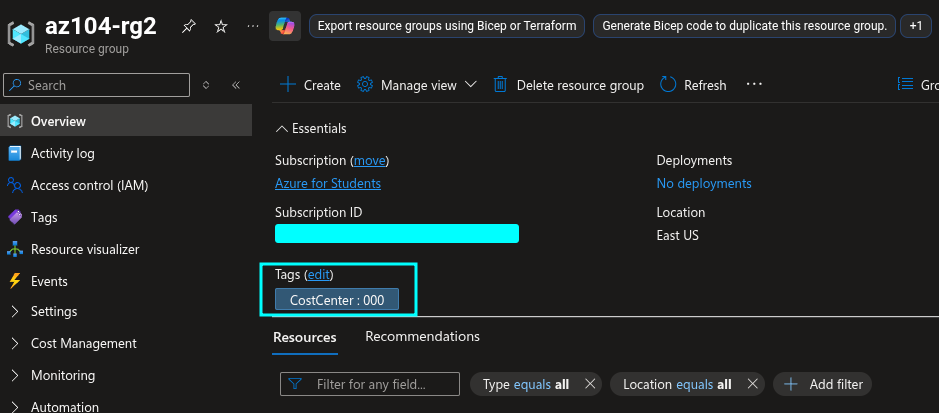
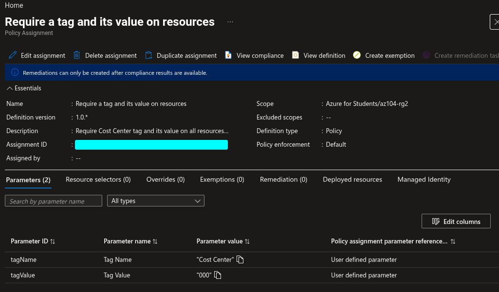
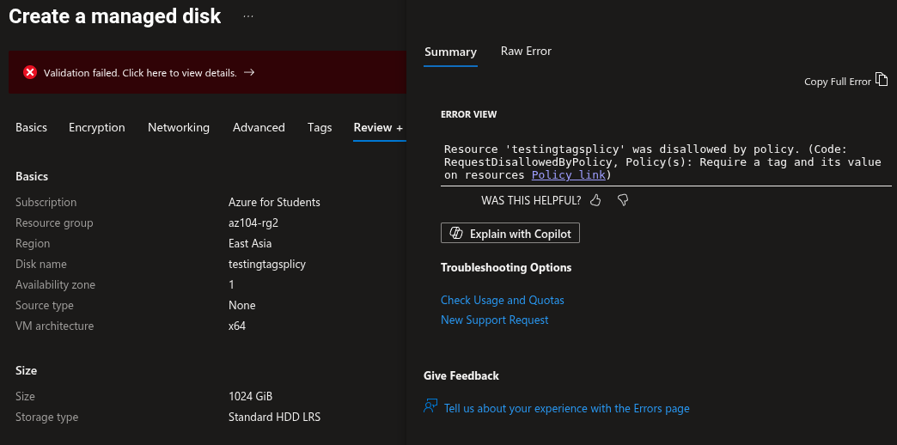
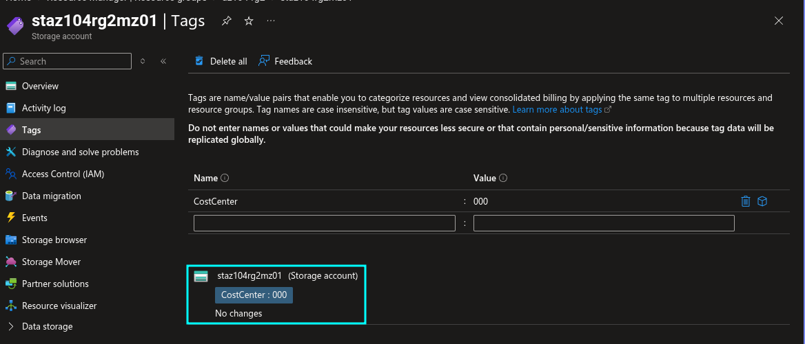
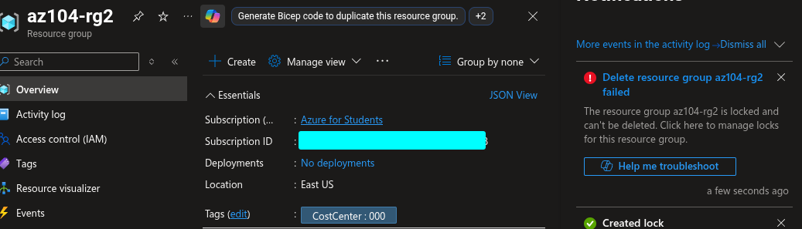

# Lab 02b: Manage Governance via Azure Policy

**Date:** 13 September 2026  
**Status:** 🟨 In progress  
**Platform:** Microsoft Azure for Students  
**Resource group:** `az104-rg2`  
**Region:** East US

## Objective

Use Azure tags, Azure Policy, remediation, managed identities, and resource locks to implement governance controls.

## Tasks Completed

- [ ] Created the `az104-rg2` resource group
- [ ] Added the `Cost Center = 000` tag to the resource group
- [ ] Assigned the Require a tag and its value on resources policy
- [ ] Verified that an untagged storage account deployment was denied
- [ ] Removed the deny policy assignment
- [ ] Assigned the Inherit a tag from the resource group if missing policy
- [ ] Created a remediation task and managed identity
- [ ] Created a storage account without manually assigning the Cost Center tag
- [ ] Verified that the storage account inherited `Cost Center = 000`
- [ ] Created a Delete resource lock on the resource group
- [ ] Verified that the Delete lock blocked resource-group deletion
- [ ] Removed the lock and deleted lab resources

## Resource Group Tag

| Tag name | Tag value | Scope |
|---|---|---|
| Cost Center | 000 | `az104-rg2` resource group |

## Policy Comparison

| Policy | Effect | Expected Result |
|---|---|---|
| Require a tag and its value on resources | Deny | Prevents creation or update of resources that do not have `Cost Center = 000` |
| Inherit a tag from the resource group if missing | Modify | Adds `Cost Center = 000` from the parent resource group when a child resource is missing the tag |

## Verification

### Tag on the resource group



### Deny policy assignment



### Denied storage account deployment



### Inherited Cost Center tag



### Delete lock test



## Key Lessons

- Tags are name/value metadata used to organize, report on, govern, and manage Azure resources.
- Azure Policy can apply governance at management-group, subscription, resource-group, or individual-resource scope.
- A Deny policy prevents a non-compliant resource deployment.
- The `Require a tag and its value on resources` policy applies to resources, not resource groups.
- A Modify policy can add or change eligible resource properties or tags during resource creation or update.
- The `Inherit a tag from the resource group if missing` policy adds the parent resource group's tag only when the resource does not already have that tag.
- A managed identity gives an Azure Policy assignment permission to remediate resources.
- A Delete lock protects a resource group from accidental deletion, but it must be removed before deliberate cleanup.

## Troubleshooting

| Issue | Cause | Resolution |
|---|---|---|
| Policy did not take effect immediately | Policy assignment propagation can take several minutes | Waited 5–10 minutes, refreshed the portal, and tried the deployment again |
| Storage account deployment failed | The required Cost Center tag was missing | Confirmed that the Deny policy was working as expected |
| Resource group could not be deleted | The `rg-lock` Delete lock was active | Removed the lock before deleting the resource group |

## Remediation Verification

The storage account initially appeared as non-compliant because it did not contain the required Cost Center tag. I created a remediation task for the Modify policy. The task started successfully and was shown as In Progress.

After remediation completed, I refreshed the storage account and verified that Azure automatically added:

```text
Cost Center = 000
```

This confirmed that the policy inherited the tag from the resource group.


## Cleanup

- [ ] Deleted the Require a tag and its value on resources assignment
- [ ] Deleted the Inherit a tag from the resource group if missing assignment
- [ ] Removed the remediation task if still present
- [ ] Removed the `rg-lock` Delete lock
- [ ] Deleted the storage account
- [ ] Deleted the `az104-rg2` resource group
- [ ] Confirmed the lab resources were removed

## Reflection

This lab demonstrated the difference between preventing non-compliance and automatically correcting it. The Deny effect blocked an untagged resource deployment, while the Modify effect added the missing Cost Center tag automatically from the parent resource group. The Delete lock provided an additional safeguard against accidental removal of the lab environment.
