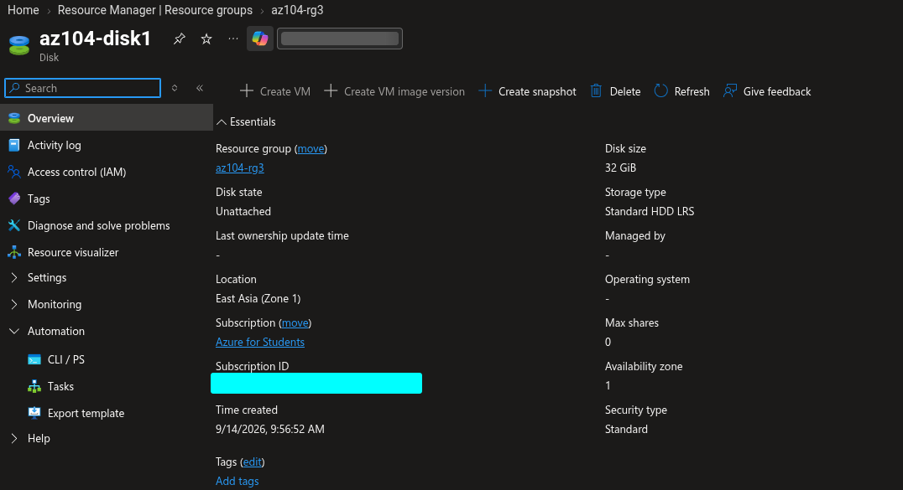
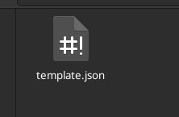
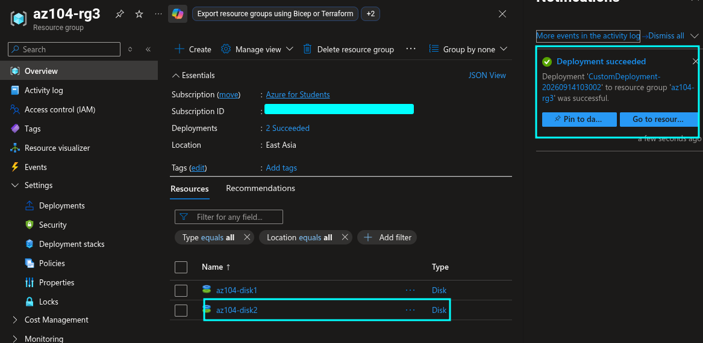
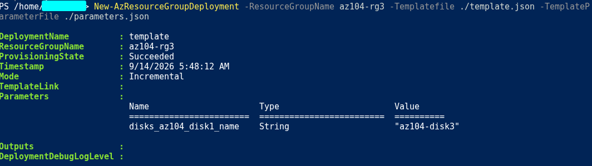
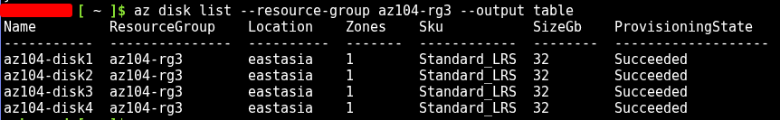
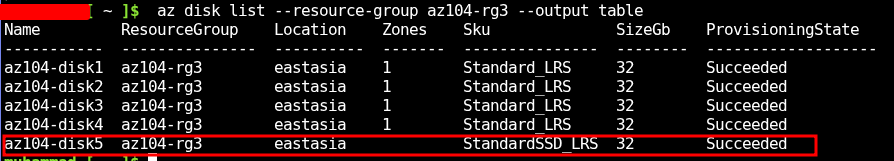

# Lab 03: Manage Azure Resources by Using ARM Templates

**Date:** 14 September 2026  
**Status:** ✅ Completed  
**Platform:** Microsoft Azure for Students  
**Resource group:** `az104-rg3`  
**Region:** East US

## Objective

Create a managed disk manually, export its Azure Resource Manager template, modify and redeploy the template, deploy resources with Azure PowerShell and Azure CLI, and deploy a managed disk using Bicep.

This lab demonstrates Infrastructure as Code (IaC): defining infrastructure in files so it can be deployed repeatedly and consistently.

## Deployment Methods

| Resource | Deployment method | Tool |
|---|---|---|
| `az104-disk1` | Manual resource creation | Azure portal |
| `az104-disk2` | Edited ARM JSON template | Azure portal custom deployment |
| `az104-disk3` | ARM JSON template | Azure Cloud Shell PowerShell |
| `az104-disk4` | ARM JSON template | Azure Cloud Shell Bash / Azure CLI |
| `az104-disk5` | Bicep template | Azure Cloud Shell Bash / Azure CLI |

## Tasks Completed

- [x] Created the `az104-rg3` resource group
- [x] Created `az104-disk1` in the Azure portal
- [x] Exported the disk as an ARM template
- [x] Downloaded the template and parameter files
- [x] Changed the template parameter to `disk_name`
- [x] Redeployed the edited template as `az104-disk2`
- [x] Configured Azure Cloud Shell PowerShell
- [x] Deployed `az104-disk3` with PowerShell
- [x] Switched Cloud Shell to Bash
- [x] Deployed `az104-disk4` with Azure CLI
- [x] Modified and deployed the Bicep file as `az104-disk5`
- [x] Verified the disk deployments
- [x] Deleted the lab resource group after collecting evidence

## Resource Configuration

| Property | Value |
|---|---|
| Resource type | Managed disk |
| Resource group | `az104-rg3` |
| Initial disk SKU | Standard HDD |
| Bicep disk SKU | StandardSSD_LRS |
| Disk size | 32 GiB |
| Source type | None |
| Region | East US |
| Availability zone | [record what you used] |

## ARM Template Parameters

The exported parameter name was changed from:

```text
disks_az104_disk1_name
```

to:

```text
disk_name
```

The parameter value for the second deployment was:

```text
az104-disk2
```

The same parameter was reused to deploy later disks with different names.

Parameter files allow deployment values to be separated from the template structure, so the same template can be reused in different deployments or environments [442][447].

## ARM Template Deployment Through the Portal

I exported the configuration of `az104-disk1`, edited the template and parameter file, and deployed a second disk named `az104-disk2`.

The deployment was performed using:

```text
Azure portal → Deploy a custom template → Build your own template in the editor
```

### Evidence







## Azure PowerShell Deployment

The PowerShell deployment command was:

```powershell
Get-AzContext

New-AzResourceGroupDeployment `
  -ResourceGroupName az104-rg3 `
  -TemplateFile template.json `
  -TemplateParameterFile parameters.json
```

I verified the disks with:

```powershell
Get-AzDisk |
  Format-Table Name, ResourceGroupName, Location, DiskSizeGb, ProvisioningState
```

### Evidence



## Azure CLI Deployment

Before deploying, I verified the active subscription:

```bash
az account show --output table
```

The ARM template was deployed with:

```bash
az deployment group create \
  --resource-group az104-rg3 \
  --template-file template.json \
  --parameters parameters.json
```

I verified the disks with:

```bash
az disk list \
  --resource-group az104-rg3 \
  --output table
```

### Evidence



## Bicep Deployment

The Bicep file was modified to use:

```text
Managed disk name: az104-disk5
Disk size: 32 GiB
SKU: StandardSSD_LRS
```

The deployment command was:

```bash
az deployment group create \
  --resource-group az104-rg3 \
  --template-file azuredeploydisk.bicep
```

The Bicep deployment produced warning `BCP081` because the original lab file used an older managed-disk API version. I verified the actual deployment result with the Azure CLI and confirmed the resource provisioning state.

Bicep provides a more concise declarative syntax for Azure deployments and compiles to ARM template representations [445][449][452].

### Evidence



## Deployment Scope

This lab used resource-group deployments. The important command patterns were:

```text
Azure PowerShell:
New-AzResourceGroupDeployment

Azure CLI:
az deployment group create
```

Azure deployments can also target subscription, management-group, or tenant scopes, but the command changes according to the scope [443][448].

## Key Lessons

- ARM templates define Azure infrastructure declaratively in JSON.
- Parameters separate deployment values from the reusable template structure.
- Exported templates can be modified and redeployed.
- PowerShell and Azure CLI use different command syntax for the same deployment scope.
- `New-AzResourceGroupDeployment` deploys an ARM template at resource-group scope.
- `az deployment group create` deploys an ARM or Bicep file at resource-group scope.
- Bicep is more concise and readable than raw ARM JSON.
- Azure Resource Manager records deployment history in the resource group.
- A successful command should always be followed by verification.
- Unattached managed disks can incur charges, so temporary resources must be removed after testing.

## Troubleshooting

| Issue | Cause | Resolution |
|---|---|---|
| BCP081 warning appeared | The lab Bicep file used an API version without locally available Bicep type metadata | Checked the actual deployment result instead of treating the warning as an automatic failure |
|  |  |  |

## Cleanup

- [x] Verified the managed disk deployments
- [x] Saved sanitized template files
- [x] Removed secrets and identifiers from files
- [x] Deleted the `az104-rg3` resource group
- [x] Confirmed that the temporary managed disks were removed
- [x] Checked Cost Management

## Reflection

This lab showed how Infrastructure as Code reduces repetitive manual work. After creating the first disk manually, I reused the exported configuration through the portal, PowerShell, Azure CLI, and Bicep. The main practical lesson was that a template is only useful when its parameters, deployment scope, tool syntax, and final resource state are all verified.
