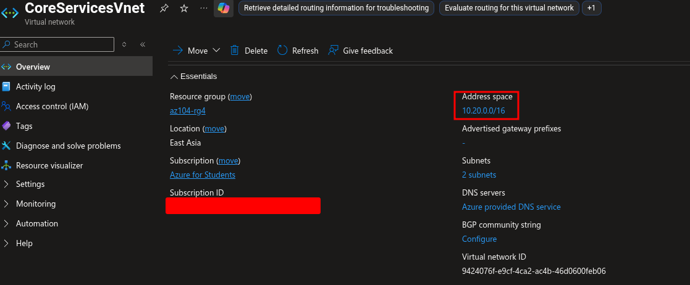
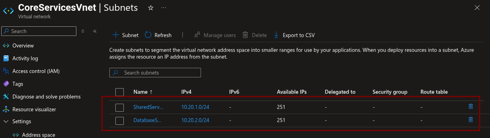
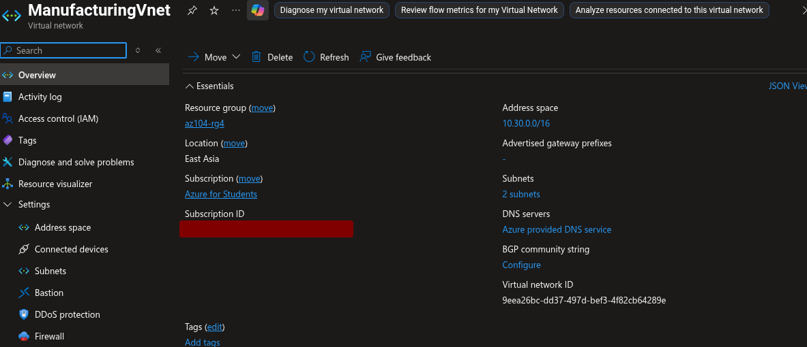
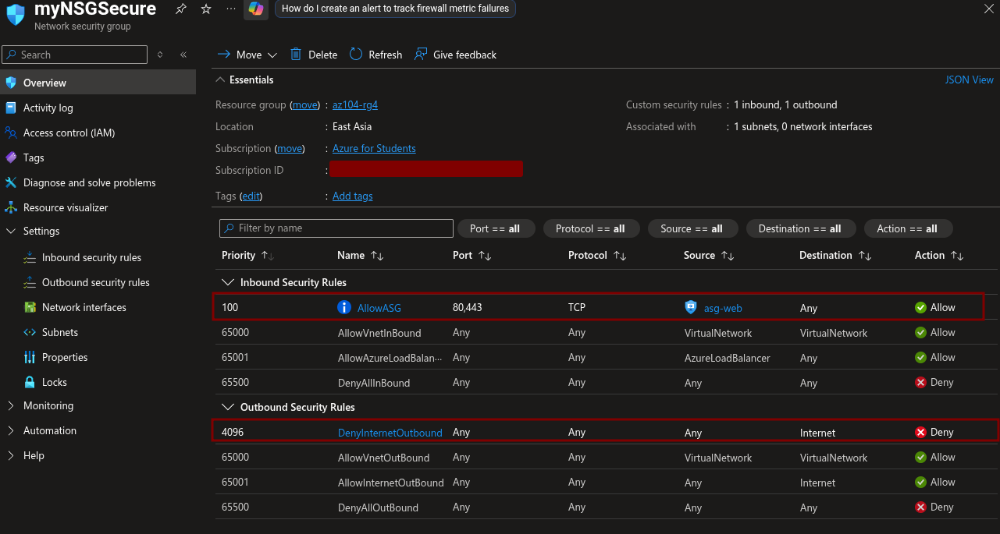
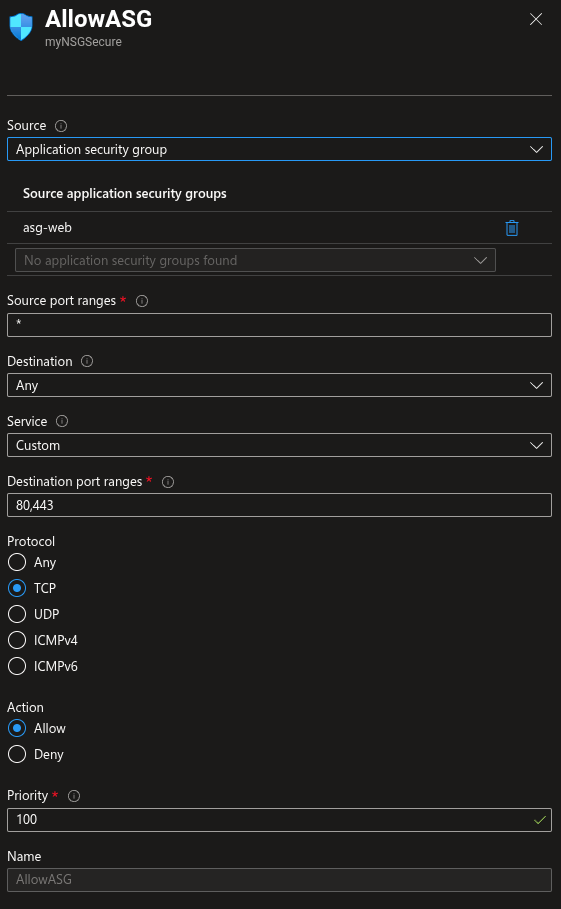
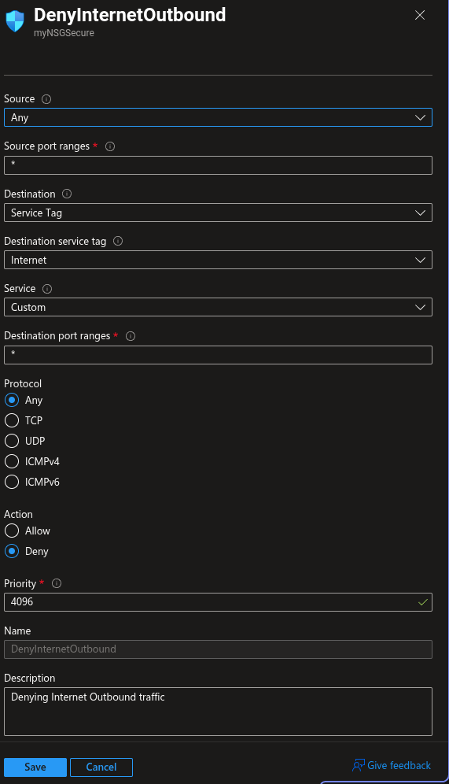
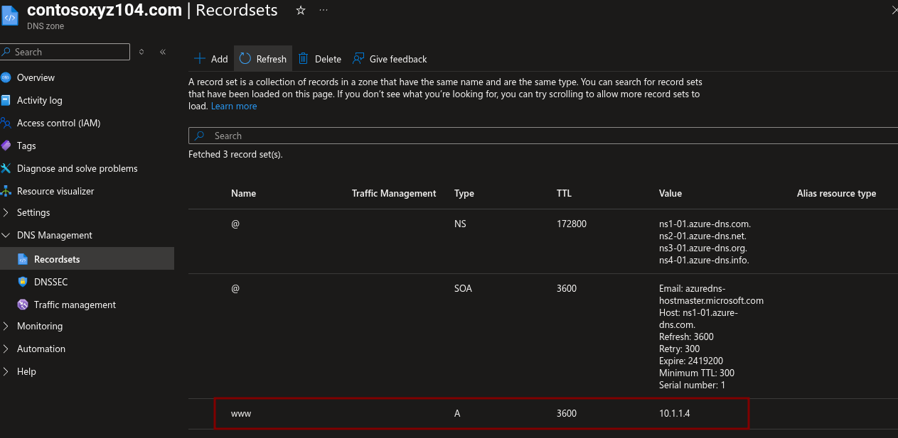
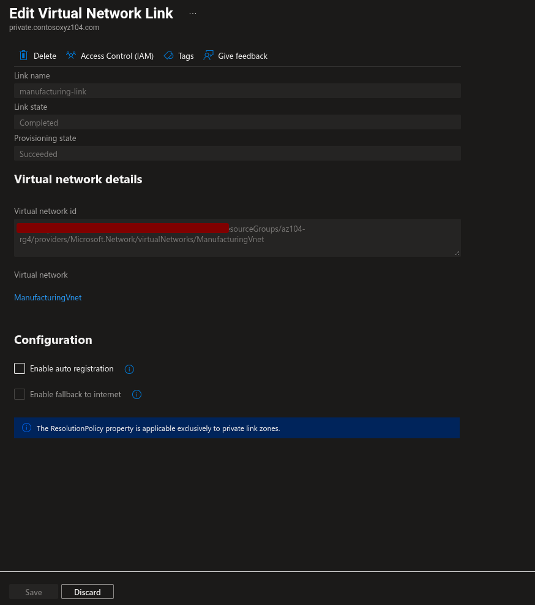
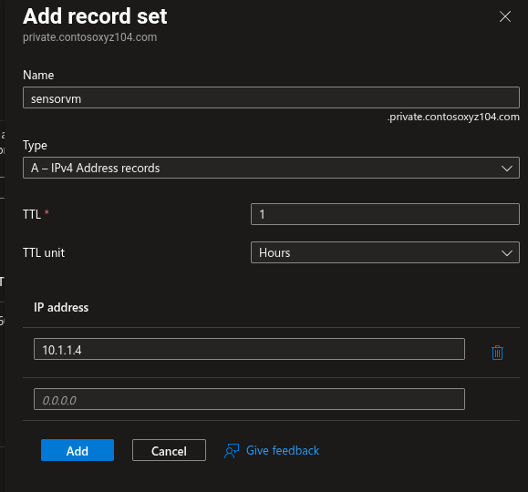
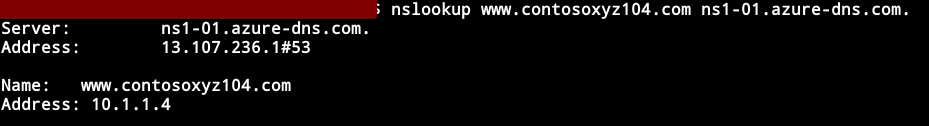

# Lab 04: Implement Virtual Networking

**Date:** 15 September 2026  
**Status:** 🟨 In progress  
**Platform:** Microsoft Azure for Students  
**Resource group:** `az104-rg4`  
**Region:** East Asia

## Objective

Create Azure virtual networks and subnets, deploy a second virtual network from a template, configure Application Security Groups and Network Security Groups, and create public and private Azure DNS zones.

## Environment Note

The official lab references East US. East US was unavailable in my Azure for Students subscription, so I used East Asia and the Azure location identifier `eastasia`.

## Network Architecture

```text
CoreServicesVnet: 10.20.0.0/16
├── SharedServicesSubnet: 10.20.10.0/24
└── DatabaseSubnet:       10.20.20.0/24

ManufacturingVnet: 10.30.0.0/16
├── SensorSubnet1: 10.30.20.0/24
└── SensorSubnet2: 10.30.21.0/24
```

The two VNet address spaces do not overlap, which allows future connectivity options without address conflicts.

## Tasks Completed

- [ ] Created `CoreServicesVnet` through the Azure portal
- [ ] Configured the `10.20.0.0/16` address space
- [ ] Created `SharedServicesSubnet`
- [ ] Created `DatabaseSubnet`
- [ ] Exported the CoreServicesVnet template
- [ ] Modified the template for `ManufacturingVnet`
- [ ] Created `SensorSubnet1`
- [ ] Created `SensorSubnet2`
- [ ] Created the `asg-web` Application Security Group
- [ ] Created the `myNSGSecure` Network Security Group
- [ ] Associated the NSG with `SharedServicesSubnet`
- [ ] Created the `AllowASG` inbound rule
- [ ] Created the `DenyInternetOutbound` outbound rule
- [ ] Created a public DNS zone
- [ ] Created a public `www` A record
- [ ] Created a private DNS zone
- [ ] Linked the private DNS zone to `ManufacturingVnet`
- [ ] Created the `sensorvm` private A record
- [ ] Deleted the lab resource group after evidence collection

## CoreServicesVnet

| Setting | Value |
|---|---|
| Name | `CoreServicesVnet` |
| Address space | `10.20.0.0/16` |
| Region | East Asia |
| Resource group | `az104-rg4` |

| Subnet | Address range |
|---|---|
| `SharedServicesSubnet` | `10.20.10.0/24` |
| `DatabaseSubnet` | `10.20.20.0/24` |





## ManufacturingVnet

| Setting | Value |
|---|---|
| Name | `ManufacturingVnet` |
| Address space | `10.30.0.0/16` |
| Region | East Asia |
| Resource group | `az104-rg4` |

| Subnet | Address range |
|---|---|
| `SensorSubnet1` | `10.30.20.0/24` |
| `SensorSubnet2` | `10.30.21.0/24` |

The ManufacturingVnet was created by modifying and redeploying the exported ARM template.



## ASG and NSG

| Resource | Value |
|---|---|
| Application Security Group | `asg-web` |
| Network Security Group | `myNSGSecure` |
| NSG association | `CoreServicesVnet/SharedServicesSubnet` |

The Application Security Group represents application workloads such as web servers. The Network Security Group contains rules that control network traffic for an associated subnet or network interface.



## Inbound Rule

| Property | Value |
|---|---|
| Name | `AllowASG` |
| Source | Application security group |
| Source ASG | `asg-web` |
| Source port | `*` |
| Destination | Any |
| Destination ports | `80,443` |
| Protocol | TCP |
| Action | Allow |
| Priority | `100` |



## Outbound Rule

| Property | Value |
|---|---|
| Name | `DenyInternetOutbound` |
| Source | Any |
| Destination | Service tag: Internet |
| Destination ports | `*` |
| Protocol | Any |
| Action | Deny |
| Priority | `4096` |

The custom deny rule has a lower priority number than the default Internet allow rule, so it is evaluated first.



## Public DNS

| Property | Value |
|---|---|
| Zone | `contosoxyz104.com` |
| Record | `www` |
| Type | A |
| IP address | `10.1.1.4` |
| TTL | `1` |

The IP address is a documentation value for this lab. It does not represent a real public web server.



## Private DNS

| Property | Value |
|---|---|
| Zone | `private.contosoxyz104.com` |
| VNet link | `manufacturing-link` |
| Linked VNet | `ManufacturingVnet` |
| Record | `sensorvm` |
| Type | A |
| IP address | `10.1.1.4` |
| TTL | `1` |

Private DNS zones provide name resolution only to linked virtual networks.





## DNS Verification

```bash
nslookup www.contosoxyz104.com <azure-dns-name-server>
```

Expected result:

```text
Address: 10.1.1.4
```



## Key Lessons

- A VNet address space must be planned before creating subnets.
- Subnets must fit within the VNet address space and must not overlap.
- Azure reserves five IP addresses in every subnet.
- ARM templates can be exported, edited, and reused for similar networks.
- ASGs group application workloads for NSG rule targeting.
- NSGs filter traffic using rules, priorities, sources, destinations, ports, protocols, and actions.
- Lower NSG priority numbers are evaluated before higher numbers.
- Public DNS zones are intended for internet-facing name resolution.
- Private DNS zones are accessible through linked virtual networks.
- A public DNS record does not automatically make a private IP address publicly reachable.
- DNS configuration and network reachability are separate concerns.

## Troubleshooting

| Issue | Cause | Resolution |
|---|---|---|
| East US was unavailable | Subscription region restriction or capacity limitation | Used East Asia and recorded the environment difference |
|  |  |  |

## Cleanup

- [ ] Deleted the `AllowASG` and `DenyInternetOutbound` rules if required
- [ ] Deleted the public DNS zone
- [ ] Deleted the private DNS zone and VNet link
- [ ] Deleted the ASG and NSG
- [ ] Deleted the `az104-rg4` resource group
- [ ] Confirmed the resource group no longer exists
- [ ] Checked Cost Management

## Reflection

This lab connected address planning, subnet design, security filtering, application grouping, and DNS. The main practical lesson was that Azure networking is built in layers: VNets provide address spaces, subnets segment them, NSGs control traffic, ASGs make rules easier to manage, and DNS provides name resolution.
