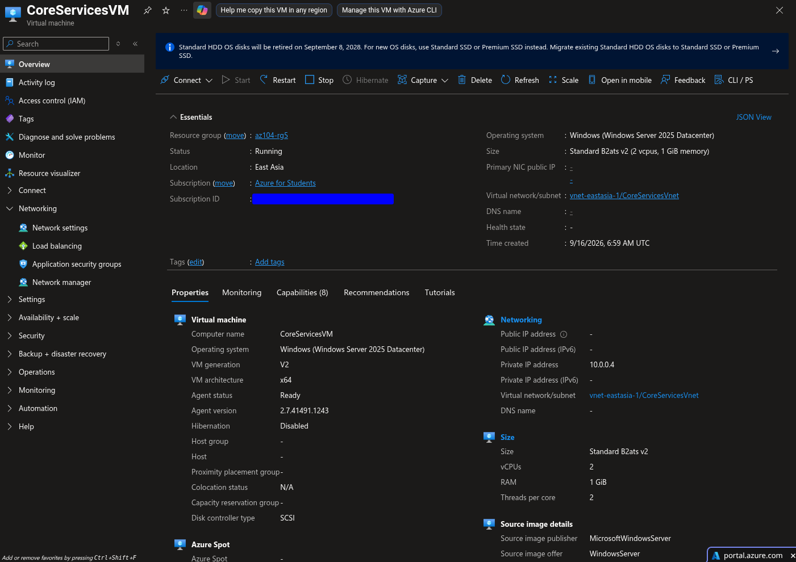
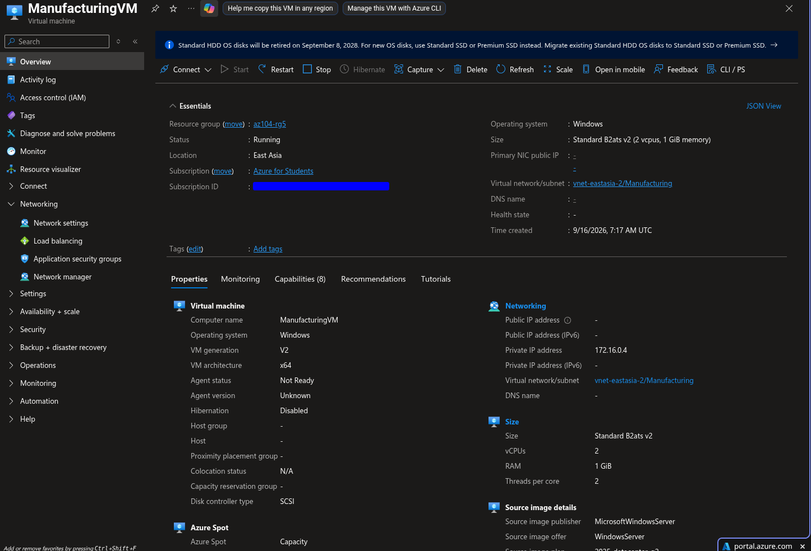
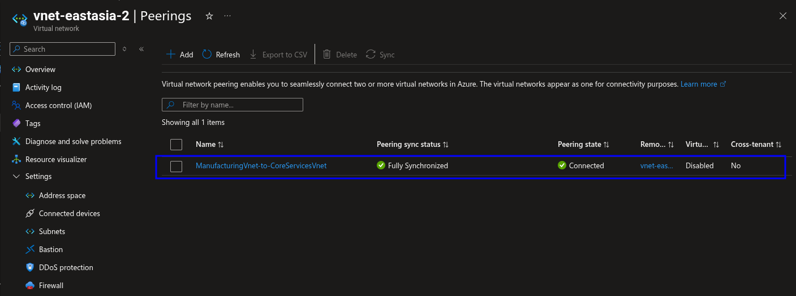
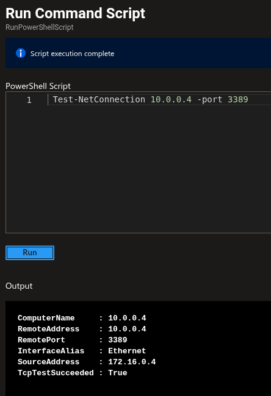
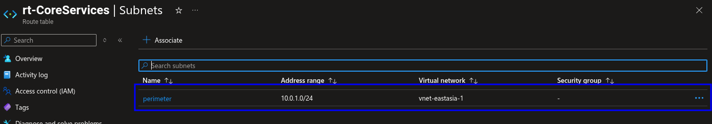
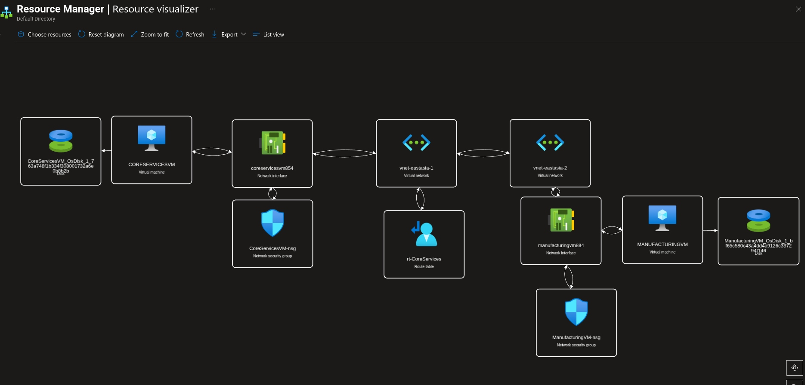

# Lab 05: Inter-Site Connectivity with Azure VNet Peering and User-Defined Routing

## Overview

This lab demonstrates private connectivity between two Azure virtual networks using VNet peering. It also validates network security controls, connectivity before and after peering, and user-defined routing through an Azure route table.

The resources were deployed in the `az104-rg5` resource group in East Asia.

## Objectives

- Deploy two private Windows virtual machines in separate VNets.
- Use non-overlapping VNet address spaces.
- Verify that connectivity is unavailable before peering.
- Configure VNet peering in both directions.
- Verify connectivity after peering.
- Review NSG associations and traffic rules.
- Create and associate a route table.
- Validate the final topology with Azure Resource Visualizer.
- Remove lab resources after completing the evidence capture.

## Architecture

```text
CoreServicesVM
  VNet: vnet-eastasia-1
  Subnet: CoreServicesVnet
  Address space: 10.0.0.0/16
  Subnet: 10.0.0.0/24
  Private IP: 10.0.0.4
  NSG: CoreServicesVM-nsg
        |
        | VNet peering
        |
ManufacturingVM
  VNet: vnet-eastasia-2
  Subnet: Manufacturing
  Address space: 172.16.0.0/16
  Subnet: 172.16.0.0/24
  NSG: ManufacturingVM-nsg
```

Both virtual machines were configured without public IP addresses and without public inbound ports. The design uses private Azure networking only.

## Resource inventory

| Resource | Configuration |
|---|---|
| Resource group | `az104-rg5` |
| Region | East Asia |
| Core VM | `CoreServicesVM` |
| Manufacturing VM | `ManufacturingVM` |
| Core VNet | `vnet-eastasia-1` |
| Core subnet | `CoreServicesVnet` |
| Core VNet range | `10.0.0.0/16` |
| Core subnet range | `10.0.0.0/24` |
| Manufacturing VNet | `vnet-eastasia-2` |
| Manufacturing subnet | `Manufacturing` |
| Manufacturing VNet range | `172.16.0.0/16` |
| Manufacturing subnet range | `172.16.0.0/24` |
| Core private IP | `10.0.0.4` |
| Core NSG | `CoreServicesVM-nsg` |
| Manufacturing NSG | `ManufacturingVM-nsg` |
| Route table | `rt-CoreServices` |
| Public IPs | None |
| VM size | Standard B2ats v2 |

## Naming note

The Azure portal generated the VNet names `vnet-eastasia-1` and `vnet-eastasia-2` when the VNets were created through the VM deployment wizard. The first subnet is named `CoreServicesVnet` and the second is named `Manufacturing`.

This differs from the original logical naming convention, but the network design remains valid because the address spaces are separate and non-overlapping:

- Core network: `10.0.0.0/16`.
- Manufacturing network: `172.16.0.0/16`.

## Lab procedure

### 1. Deploy the core VM and network

Deploy `CoreServicesVM` with the following characteristics:

- East Asia region.
- Standard B2ats v2 size.
- Windows Server x64.
- No public IP.
- No public inbound ports.
- Private address in the `10.0.0.0/24` subnet.
- NSG attached to the network interface.



### 2. Deploy the manufacturing VM and network

Deploy `ManufacturingVM` in a separate VNet with:

- VNet address space: `172.16.0.0/16`.
- Subnet name: `Manufacturing`.
- Subnet range: `172.16.0.0/24`.
- No public IP.
- No public inbound ports.
- Standard B2ats v2 size.



### 3. Test connectivity before peering

Before configuring peering, test traffic between the VM private IP addresses using Network Watcher or PowerShell.

Example command:

```powershell
Test-NetConnection -ComputerName <destination-private-ip> -Port 3389
```

Expected result before peering:

```text
TcpTestSucceeded: False
```

The exact result also depends on the destination NSG and Windows Firewall. Record the source, destination, port, time, and diagnostic result.


### 4. Configure VNet peering

Create a peering from `vnet-eastasia-1` to `vnet-eastasia-2`, then create the reverse peering from `vnet-eastasia-2` to `vnet-eastasia-1`.

For both peerings:

- Allow virtual network access: Enabled.
- Allow forwarded traffic: Enable only if required by the lab design.
- Allow gateway transit: Leave disabled unless a gateway is present.
- Use remote gateways: Leave disabled unless a gateway is present.

Verify that both peering objects show:

```text
Peering status: Connected
```



### 5. Test connectivity after peering

Repeat the connectivity test after both peering links show `Connected`.

```powershell
Test-NetConnection -ComputerName <destination-private-ip> -Port 3389
```

A successful connection requires the route, NSG, and Windows Firewall to allow the selected port. If the port remains blocked, use Network Watcher and effective-route information to distinguish a routing issue from a security-rule issue.



### 6. Create and associate the route table

Create the route table:

```text
Name: rt-CoreServices
Resource group: az104-rg5
Region: East Asia
Propagate gateway routes: Yes
```

Gateway route propagation controls whether routes learned from an Azure VPN Gateway or ExpressRoute gateway are propagated to an associated subnet. It does not create a VPN or ExpressRoute gateway and does not replace VNet peering.

After creating the route table:

1. Add the custom route required by the lab.
2. Associate the route table with the intended subnet.
3. Verify the association from the subnet configuration.
4. Inspect effective routes or use Network Watcher.
5. Confirm that the route behaves as expected.

A route table has no traffic effect until it contains a route and is associated with a subnet.



### 7. Capture the final topology

Open **Resource Visualizer** and select the resources in `az104-rg5`. Confirm that the diagram shows:

- Both virtual machines.
- Both managed OS disks.
- Both network interfaces.
- Both network security groups.
- Both virtual networks.
- The route table `rt-CoreServices`.
- The network relationships between these resources.



## Evidence directory

```text
03-networking/
├── lab-04-screenshots/
├── lab-04-virtual-networking.md
├── lab-05-intersite-connectivity.md
└── lab-05-screenshots/
    ├── 01-core-services-vm-and-vnet.png
    ├── 02-manufacturing-vm-and-vnet.png
    ├── 03-connectivity-test-before-peering.png
    ├── 04-vnet-peerings-connected.png
    ├── 05-test-connection-after-peering.png
    ├── 06-user-defined-route-and-association.png
    └── 07-azure-vnet-peering-routing-topology.png
```

## Troubleshooting

### Peering does not show Connected

Confirm that peering was created in both directions and that the two VNets have non-overlapping address spaces.

### Connectivity fails after peering

Check the destination private IP, effective routes, NSG rules, Windows Firewall, subnet route-table association, and the selected TCP or UDP port.

### Route table does not change traffic

Confirm that a custom route exists and that the route table is associated with the correct subnet. Creating the route table alone is not sufficient.

### VM has no public access

This is expected. Both VMs were intentionally deployed without public IP addresses and public inbound ports. Use Azure Bastion, Run Command, or another approved private management path if administrative access is required.

## Security considerations

- Keep public IP addresses disabled unless explicitly required.
- Do not enable unrestricted inbound Internet access for testing.
- Limit NSG rules to the required source ranges and ports.
- Do not commit passwords, private keys, subscription identifiers, or account details.
- Redact sensitive portal information before publishing screenshots.

## Cleanup

After completing the tests and saving evidence, delete the resource group:

```text
az104-rg5
```

This removes the VMs, disks, NICs, NSGs, VNets, peerings, route table, and other resources deployed inside the group. Verify that no resources outside the lab need to be retained before deletion.

## Expected outcome

The final environment demonstrates a private two-VNet Azure design. The VNets begin isolated, become reachable through bidirectional peering, and are then evaluated with NSG and user-defined-route controls. The final Resource Visualizer screenshot documents the deployed topology and provides a concise architecture reference for the portfolio repository.
