# Lab 06: Cost-Optimized Azure Traffic Management

## Azure Load Balancer and Application Gateway

## Overview

This lab demonstrates public web traffic management using two Windows Server virtual machines, an Azure Standard Load Balancer, and an Azure Application Gateway.

The implementation preserves the core Windows Server architecture while reducing unnecessary cost:

- Windows Server virtual machines use a free-eligible B-series size where available.
- OS disks use Standard HDD LRS.
- The backend VMs have no public IP addresses.
- The Standard Load Balancer exposes one public frontend.
- The Application Gateway exposes a separate public frontend for HTTP path-based routing.
- Application Gateway is deployed only for the validation period and the resource group is deleted afterward.

This is a cost-optimized adaptation of the official AZ-104 network traffic management exercise. The official exercise may specify three VMs and Standard V2 Application Gateway. This implementation uses two manually deployed Windows VMs and the Basic Application Gateway tier to reduce resource usage while still demonstrating Layer 4 and Layer 7 traffic management.

## Architecture

```text
                                  Internet
                                     |
                    ┌────────────────┴────────────────┐
                    |                                 |
                    v                                 v
        Azure Standard Load Balancer       Azure Application Gateway
               Layer 4: TCP/80              Layer 7: HTTP path routing
          Public IP: az104-lbpip             Public IP: az104-gwppip
          Frontend: az104-fe                Listener: az104-listener
                    |                                 |
                    | TCP/80                          | HTTP/80
                    v                                 v
             Backend pool: az104-be             Path-based rules
                    |                         /image/* → core VM
          ┌─────────┴─────────┐               /video/* → manufacturing VM
          |                   |                         |
          v                   v                         |
   LAB06-COREVM       LAB06-MANUFACTURINGVM             |
   IIS web server      IIS web server                    |
   Private IP only    Private IP only                    |
          |                   |                         |
          └───────────────────┴─────────────────────────┘
                              |
                              v
                    Virtual network: lab06-vnet
                    Address space: 10.60.0.0/16
                              |
             ┌────────────────┴─────────────────┐
             |                                  |
             v                                  v
       web-subnet                         appgw-subnet
       10.60.1.0/24                        10.60.3.0/27
       Two Windows VMs                     Application Gateway only
```

## Resource Inventory

| Resource | Name | Configuration |
|---|---|---|
| Resource group | `az104-rg6` | Temporary lab resource group |
| Virtual network | `lab06-vnet` | `10.60.0.0/16` |
| Backend subnet | `web-subnet` | `10.60.1.0/24` |
| Gateway subnet | `appgw-subnet` | `10.60.3.0/27` |
| Core VM | `LAB06-COREVM` | Windows Server, B-series, Standard HDD LRS |
| Manufacturing VM | `LAB06-MANUFACTURINGVM` | Windows Server, B-series, Standard HDD LRS |
| Network security group | `lab06-web-nsg` | Allows required HTTP and health-probe traffic |
| Standard Load Balancer | `az104-lb` | Public, Regional, Standard SKU |
| Load Balancer frontend | `az104-fe` | Public IPv4 |
| Load Balancer public IP | `az104-lbpip` | Standard, static |
| Load Balancer backend pool | `az104-be` | Both VM NICs |
| Health probe | `az104-hp` | TCP port 80, 5-second interval |
| Load-balancing rule | `az104-lbrule` | TCP/80 to TCP/80 |
| Application Gateway | `az104-appgw` | Basic tier, public HTTP frontend |
| Gateway public IP | `az104-gwppip` | Public IPv4 |
| Default gateway backend | `az104-appgwbe` | Both VM NICs |
| Image backend | `az104-imagebe` | Core VM only |
| Video backend | `az104-videobe` | Manufacturing VM only |
| Gateway listener | `az104-listener` | HTTP port 80 |
| Gateway rule | `az104-gwrule` | Default and path-based routing |

## Cost-Optimization Decisions

- `Standard_B2ats_v2` was used when available and marked free-eligible by the subscription.
- Standard HDD LRS was used instead of Premium SSD.
- No public IPs were assigned to the backend VM NICs.
- No Bastion, NAT Gateway, VPN Gateway, Azure Firewall, Backup, or Site Recovery resources were deployed.
- Application Gateway was created only after the low-cost foundation and Load Balancer tests were complete.
- The complete resource group was deleted after evidence capture.

The Basic Application Gateway tier was selected for this small demonstration. This differs from the official Standard V2 configuration but still demonstrates public HTTP forwarding and URL path-based routing.

## Evidence

All screenshots are stored in:

```text
04-traffic-management/lab-06-screenshots/
```

### 1. VNet and subnets

The VNet contains the backend subnet and a dedicated Application Gateway subnet.

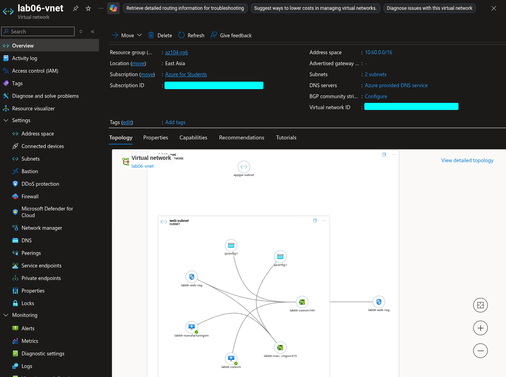

### 2. Windows backend VMs

The two Windows Server VMs use private networking, B-series compute, and Standard HDD storage.

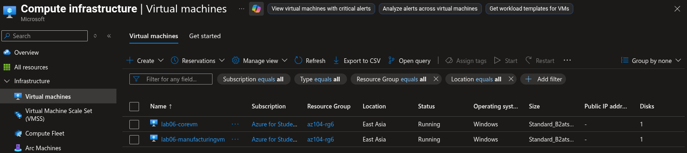

### 3. Core VM IIS configuration

IIS was installed and configured on the core backend VM.


### 4. Manufacturing VM IIS configuration

IIS was installed and configured on the manufacturing backend VM.

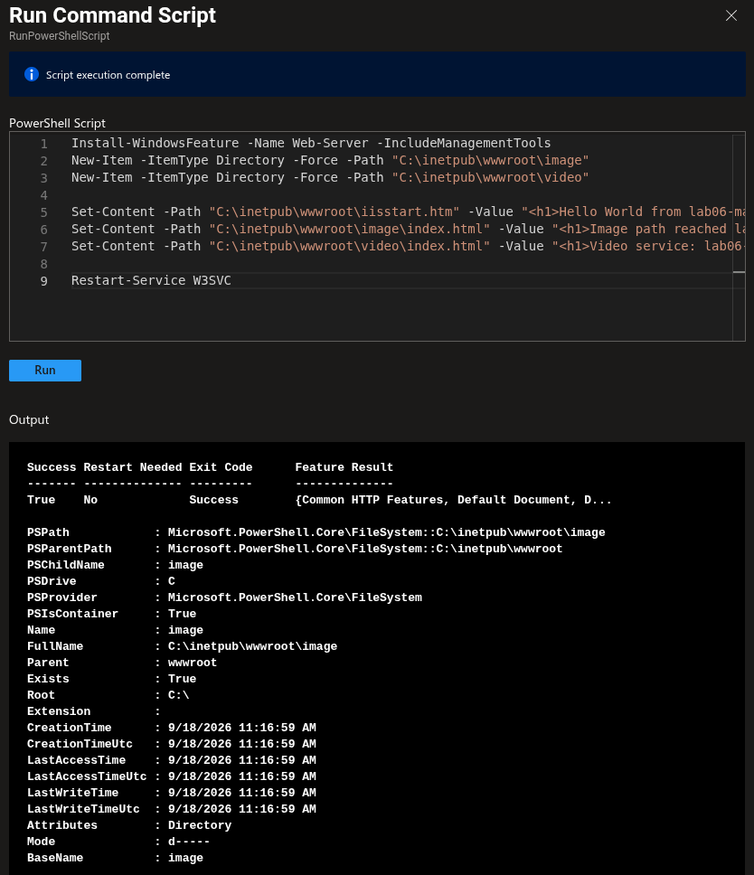

### 5. Standard Load Balancer configuration

The Load Balancer includes a public frontend, backend pool, health probe, and TCP/80 load-balancing rule.

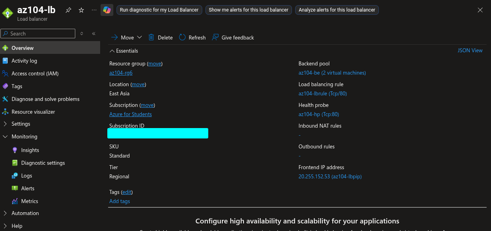

### 6. Load Balancer response from the core VM

The public Load Balancer endpoint returned the IIS response from the core backend VM.

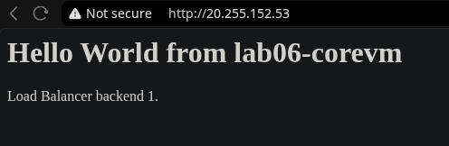

### 7. Load Balancer response from the manufacturing VM

A separate client connection or private browser session returned the IIS response from the manufacturing backend VM.

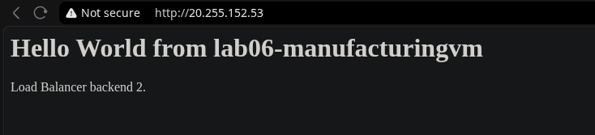

### 8. Application Gateway review

This screenshot records the final gateway configuration before deployment.

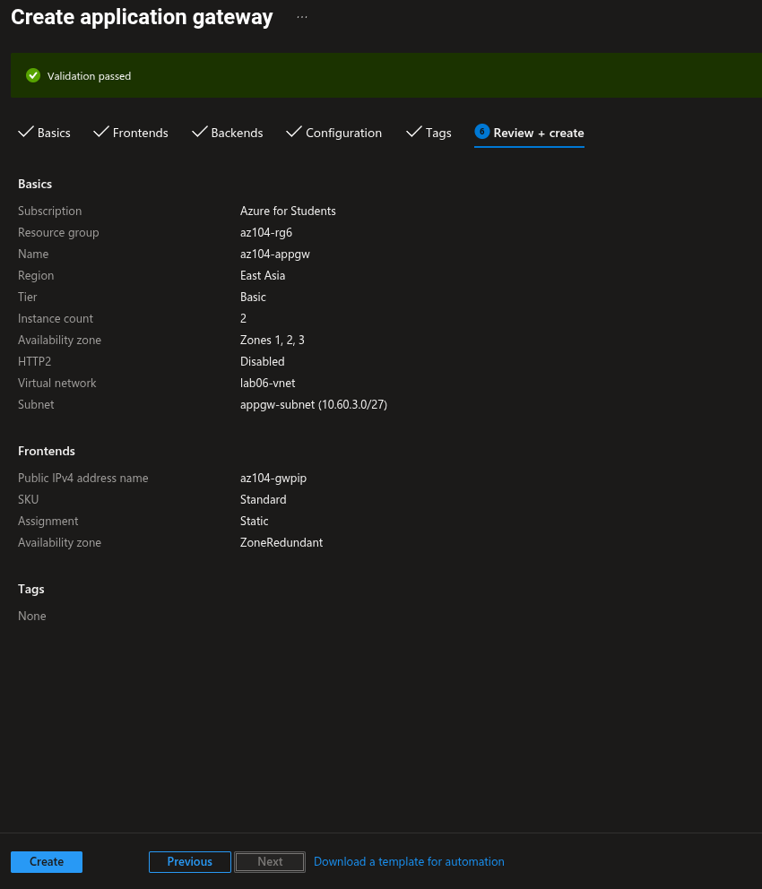

### 9. Application Gateway backend health

Both backend VMs should show Healthy before path-routing tests are performed.

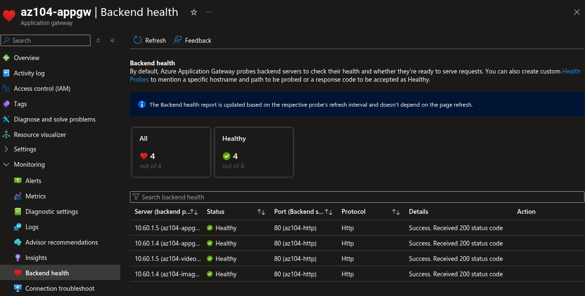

### 10. Image path routing

The `/image/` path routes to the core VM backend pool.

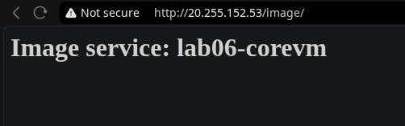

### 11. Video path routing

The `/video/` path routes to the manufacturing VM backend pool.

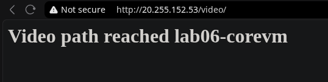

### 12. Application Gateway overview

The overview confirms the deployed gateway, public frontend, region, tier, and networking configuration.

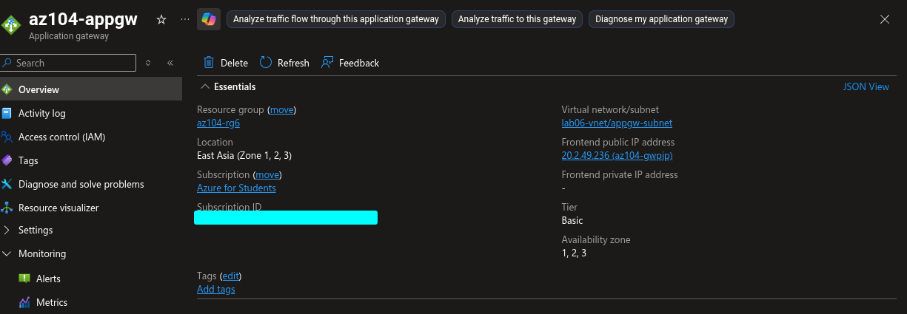

### 13. Full resource topology

Azure Resource Visualizer shows the relationship between the VNet, backend VMs, NICs, NSG, Load Balancer, Application Gateway, managed disks, and public IP resources.

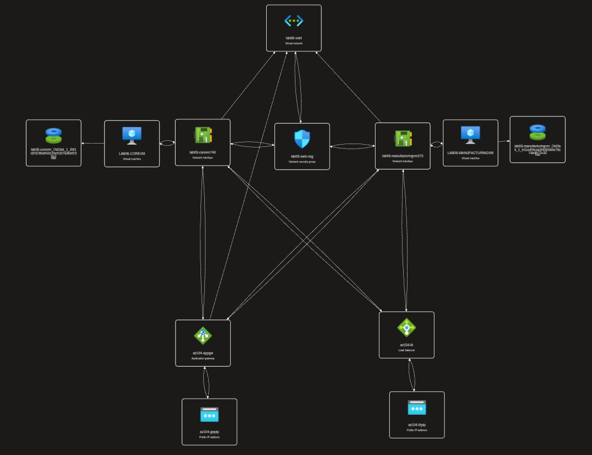

## Traffic Flows

### Standard Load Balancer

```text
Client
  → az104-lbpip
  → az104-fe
  → az104-lbrule TCP/80
  → az104-hp health validation
  → az104-be
  → LAB06-COREVM or LAB06-MANUFACTURINGVM
```

The Standard Load Balancer distributes Layer 4 TCP traffic across healthy backend instances.

### Application Gateway image path

```text
Client
  → az104-gwppip
  → az104-listener HTTP/80
  → az104-gwrule
  → /image/* path rule
  → az104-imagebe
  → LAB06-COREVM
```

### Application Gateway video path

```text
Client
  → az104-gwppip
  → az104-listener HTTP/80
  → az104-gwrule
  → /video/* path rule
  → az104-videobe
  → LAB06-MANUFACTURINGVM
```

## Validation Results

### Load Balancer

Test URL:

```text
http://<az104-lbpip-public-ip>/
```

Expected responses:

```text
Hello World from LAB06-COREVM
Hello World from LAB06-MANUFACTURINGVM
```

The exact backend shown may vary because the Load Balancer distributes TCP flows and a browser may reuse an existing connection.

### Application Gateway

Test URLs:

```text
http://<az104-gwppip-public-ip>/image/
http://<az104-gwppip-public-ip>/video/
```

Expected routing:

| URL path | Expected backend |
|---|---|
| `/image/` | `LAB06-COREVM` |
| `/video/` | `LAB06-MANUFACTURINGVM` |

Backend health must show Healthy before these tests are considered valid.

## Troubleshooting

### Backend health is unhealthy

Check that:

- IIS is running on both VMs.
- TCP port 80 is allowed by the subnet or NIC NSG.
- Windows Firewall permits IIS HTTP traffic.
- The backend HTTP setting uses port 80.
- The backend pool contains the correct NICs or private IPs.
- The Application Gateway subnet is dedicated.
- No incorrect route table or restrictive NSG is associated with the gateway subnet.

### Application Gateway returns 502

Check Backend health first. A 502 commonly indicates that the gateway cannot establish a valid connection to a backend or that the backend probe is failing.

### Load Balancer shows only one VM

Use a new private browser session or another client connection. TCP flow hashing and browser connection reuse can keep multiple requests on the same backend.

### Images do not render on GitHub

The Markdown file is located in `04-traffic-management`, and the screenshots are in `04-traffic-management/lab-06-screenshots`. Therefore, image references must use:

```markdown

```

Do not use `./04-traffic-management/lab-06-screenshots/...` from this Markdown file, because that repeats the parent directory.

## Cleanup

After capturing all evidence, delete the entire temporary resource group:

```bash
az group delete --name az104-rg6 --yes --no-wait
```

Deleting the resource group removes the Application Gateway, gateway public IP, Load Balancer, Load Balancer public IP, VMs, disks, NICs, NSG, VNet, and subnets.

The cleanup screenshot can be stored separately as:

```text
14-resource-group-cleanup-in-progress.png
```

## Final Outcome

This cost-optimized implementation demonstrates:

- Private Windows Server backend VMs.
- Standard HDD storage and free-eligible B-series compute.
- Public Layer 4 TCP load balancing with Azure Load Balancer.
- Public Layer 7 HTTP routing with Azure Application Gateway.
- Backend health validation.
- URL path-based routing for image and video workloads.
- Resource topology visualization.
- Cost-aware deployment and complete cleanup.
