# Lab 07: Secure Azure Storage

## Overview

This lab creates and secures an Azure Storage account for blob and Azure Files workloads. It demonstrates geo-redundant storage, restricted network access, lifecycle management, private blob containers, immutable blob retention, user-delegation SAS, Azure file shares, and VNet service endpoints.

The lab uses the `az104-rg7` resource group. For this cost-conscious deployment, use the East Asia region if the original East US region is unavailable in the subscription. Use Standard performance and upload only a small test file.

## Objectives

- Create a Standard Azure Storage account.
- Configure geo-redundant storage with read access to the secondary region where available.
- Disable unrestricted public network access.
- Restrict access to selected IP addresses and a selected VNet.
- Create a private blob container.
- Configure a 180-day time-based immutable retention policy.
- Upload a blob into a folder.
- Prove that the ordinary blob URL is not anonymously accessible.
- Generate a temporary read-only user-delegation SAS URL.
- Create and use an Azure file share.
- Add a Microsoft.Storage service endpoint to a VNet.
- Confirm that storage data access is denied from outside the allowed VNet.

## Architecture

```text
                              Azure portal / browser
                                      |
                    Initially allowed from client IPv4 address
                                      |
                                      v
                    Storage account: <unique-storage-name>
                    Resource group: az104-rg7
                    Region: East Asia
                    Performance: Standard
                    Redundancy: RA-GRS where available
                    Public access: Selected networks only
                                      |
                ┌─────────────────────┼─────────────────────┐
                |                     |                     |
                v                     v                     v
       Blob service              Azure Files          Lifecycle policy
       Container: data           Share: share1         MoveToCool
       Access: private           Tier: Transaction     Base blobs older
       Folder: securitytest      optimized             than 30 days
                |                     |
                |                     |
                v                     v
       180-day immutable       Storage Browser
       retention policy        Microsoft Entra access
                |
                ├── Ordinary blob URL: denied
                └── User-delegation SAS: temporary read access

                    VNet: vnet1
                    Default subnet
                           |
             Microsoft.Storage service endpoint
                           |
                           v
             Storage firewall allows VNet traffic
             after the client IP rule is removed
```

## Resource Inventory

| Resource | Name | Configuration |
|---|---|---|
| Resource group | `az104-rg7` | Temporary lab resource group |
| Storage account | Unique lowercase alphanumeric name | Standard performance |
| Region | East Asia | Use another available region only if necessary |
| Preferred service | Azure Blob Storage | General-purpose storage account behavior |
| Redundancy | RA-GRS where available | GRS plus read access to secondary |
| Blob container | `data` | Private access |
| Upload folder | `securitytest` | Contains a small test blob |
| Blob retention | Time-based | 180 days |
| Lifecycle rule | `MoveToCool` | Move base blobs older than 30 days to Cool |
| File share | `share1` | Transaction optimized |
| VNet | `vnet1` | Default address space and subnet |
| Service endpoint | `Microsoft.Storage` | Added to `vnet1` default subnet |

## Network Security Model

The storage account is not left open to all networks. The initial configuration disables public network access. The lab then enables access only from selected networks and the current client IP so the portal can be used during the first part of the lab.

At the end of the network-restriction task:

- The local client IPv4 address is removed.
- `vnet1` and its default subnet are allowed.
- The default subnet has the `Microsoft.Storage` service endpoint.
- Storage data operations from the local browser should eventually fail.
- Resource-management pages may still be visible because control-plane access and storage data-plane access are separate.

## Task 1: Storage Account

Create a storage account with:

```text
Resource group: az104-rg7
Region: East Asia
Performance: Standard
Preferred storage type: Azure Blob Storage
Redundancy: Geo-redundant storage
Read access to secondary region: Enabled
```

When read access is enabled, the effective redundancy is normally RA-GRS. RA-GRS provides read access to the secondary endpoint while data is asynchronously replicated to the paired region.

On Networking, initially select:

```text
Public network access: Disabled
```

After deployment, change the setting to selected networks and add the current client IPv4 address:

```text
Public network access: Enabled
Public network access scope: Selected networks and IP addresses
IP rule: Current client IPv4 address
```

### Lifecycle Management

Create a lifecycle rule:

```text
Name: MoveToCool
Scope: Base blobs
Condition: Last modified more than 30 days ago
Action: Move to cool storage
```

The 30-day condition is not waited out during the lab; the screenshot records the configured policy.

### Evidence

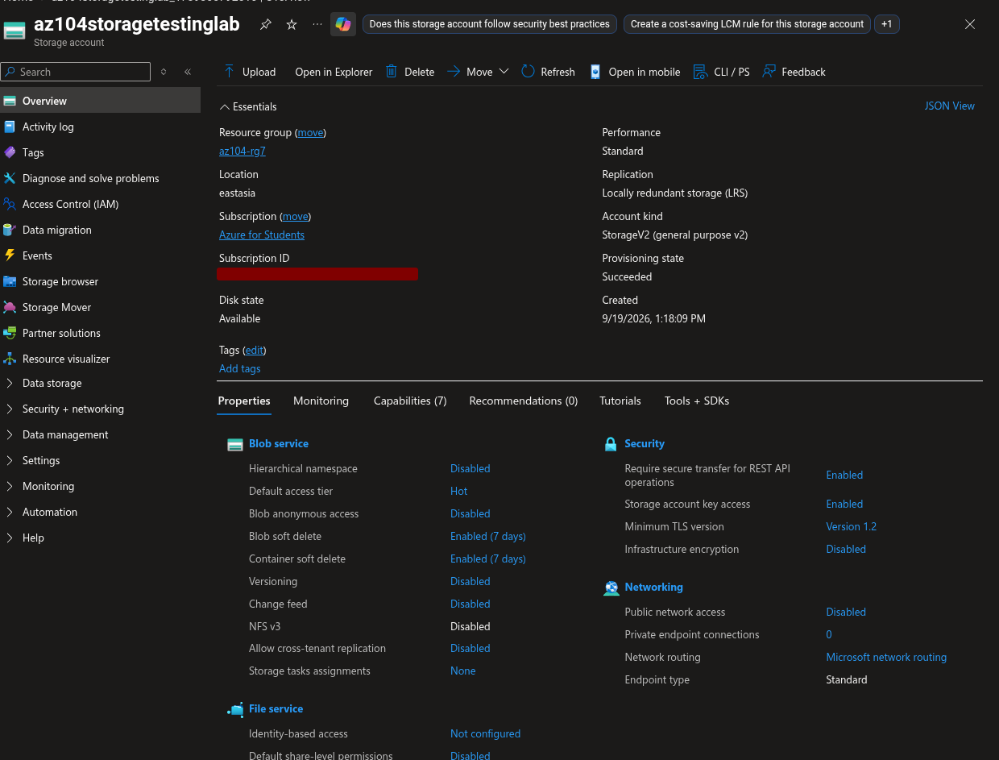

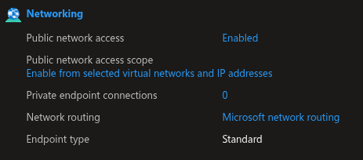

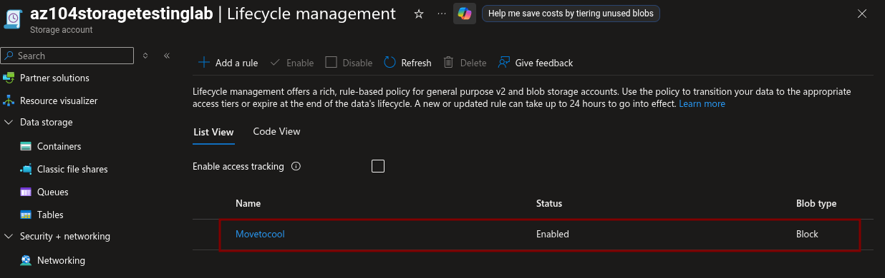

## Task 2: Secure Blob Storage

### Private Container

Create:

```text
Container name: data
Public access level: Private
```

Add immutable storage:

```text
Policy type: Time-based retention
Retention period: 180 days
```

### Upload

Enable storage account key access only if required by the portal workflow, then assign these data roles to your user:

```text
Storage Blob Data Contributor
Storage File Data Privileged Contributor
```

Upload a small file to:

```text
Container: data
Folder: securitytest
Blob type: Block blob
Block size: 4 MiB
Access tier: Hot
Encryption scope: Existing default container scope
```

### Test Anonymous Access

Copy the ordinary blob URL and open it in an InPrivate browser window.

Expected result:

```text
ResourceNotFound
```

or:

```text
PublicAccessNotPermitted
```

The failure is expected because the container has private access and does not allow anonymous blob reads.

### User-Delegation SAS

Generate a SAS for the uploaded blob:

```text
Signing method: User delegation key
Permission: Read
Start: Yesterday / current time
Expiry: Tomorrow / current time
Allowed IP addresses: Blank
```

Open the generated SAS URL in a private browser window. The file should be readable for the duration of the SAS.

Never commit the SAS URL or its query string to GitHub. Treat it as a temporary bearer credential.

### Evidence

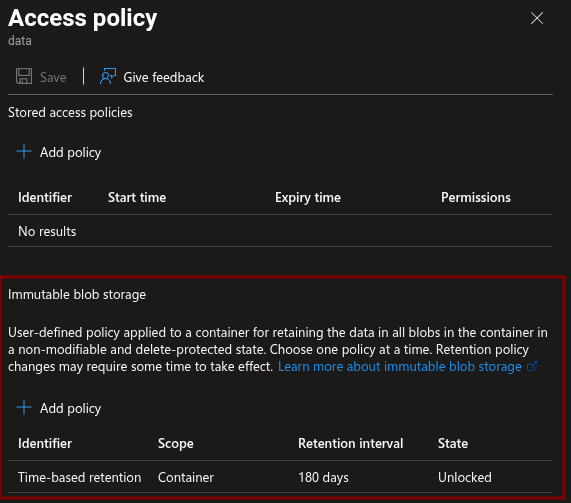

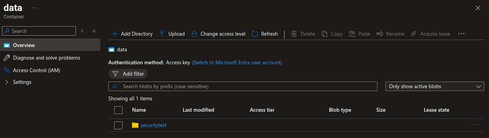

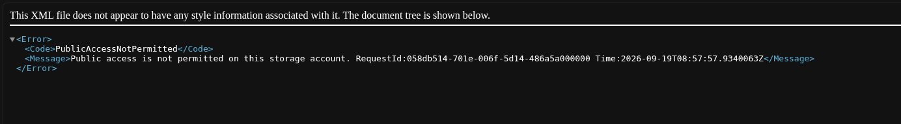

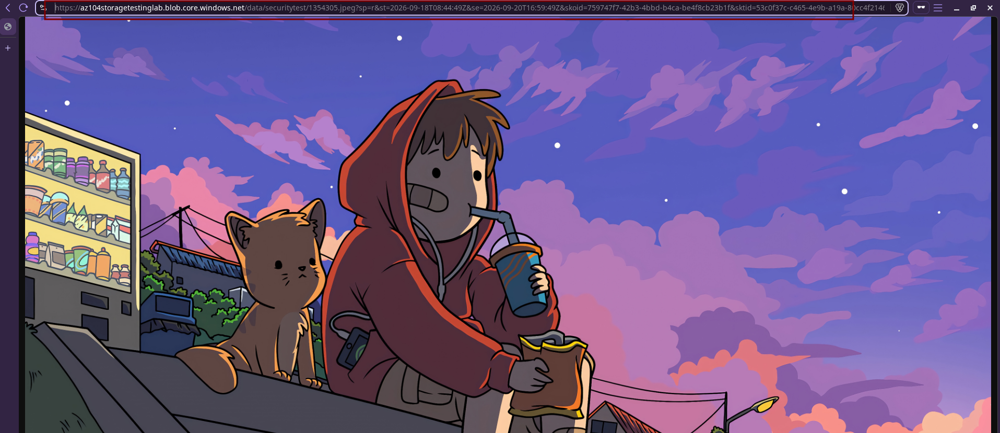

## Task 3: Azure Files

### Create File Share

Create a classic file share:

```text
Name: share1
Access tier: Transaction optimized
Backup: Disabled
```

### Upload Through Storage Browser

Open:

```text
Storage browser → Classic file shares → share1
```

If authorization fails, switch to the Microsoft Entra account authentication method and refresh the browser. Upload a small test file.

### VNet Service Endpoint

Create:

```text
Resource group: az104-rg7
VNet: vnet1
```

Use the default subnet. Add this service endpoint:

```text
Service: Microsoft.Storage
Subnet: Default
```

Then add the VNet rule to the storage account:

```text
VNet: vnet1
Subnet: Default
```

Remove the client IPv4 address from the storage account network rules and save.

After the change propagates, refresh Storage Browser from the local computer. Data-plane operations should fail because the browser is not connected from `vnet1`.

### Evidence

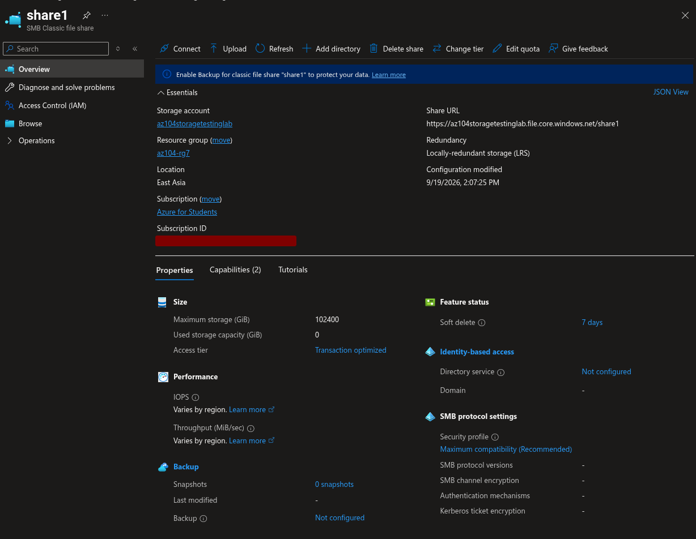

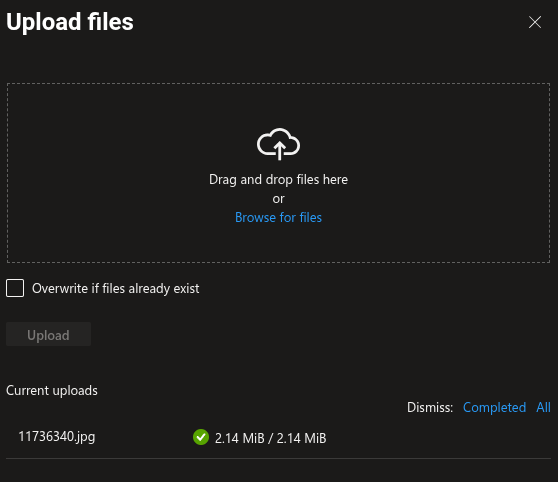

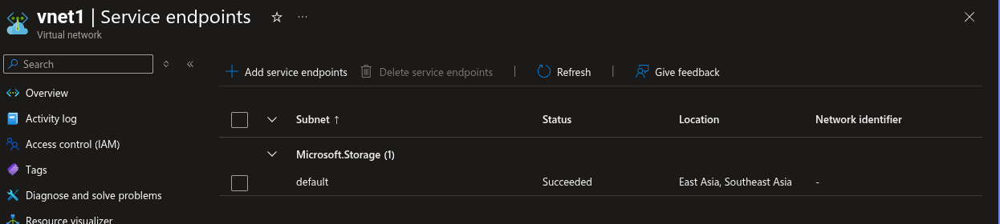

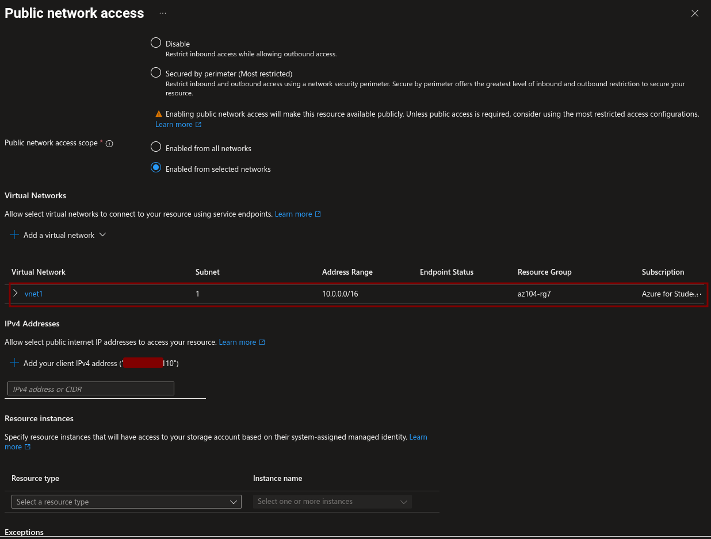

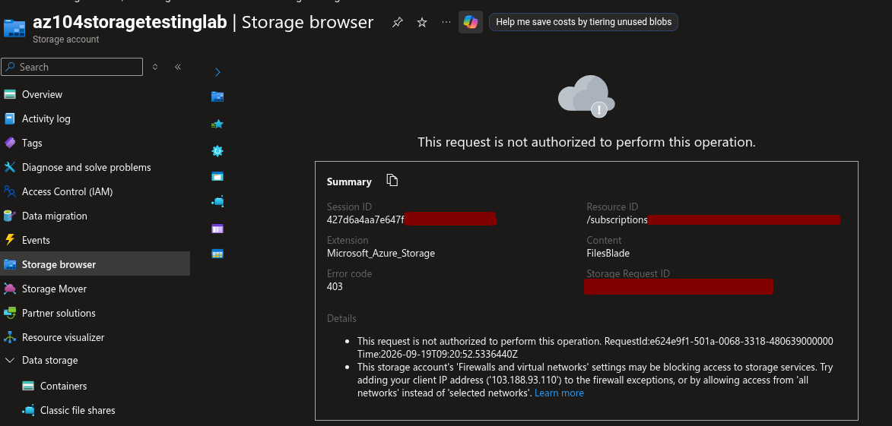

## Evidence Directory

```text
05-storage-management/
├── lab-07-secure-storage.md
└── lab-07-screenshots/
    ├── 01-storage-account-overview-and-redundancy.png
    ├── 02-storage-network-selected-networks-client-ip.png
    ├── 03-lifecycle-management-move-to-cool.png
    ├── 04-container-private-and-retention-policy.png
    ├── 05-blob-upload-securitytest-folder.png
    ├── 06-private-blob-url-access-denied.png
    ├── 07-user-delegation-sas-read-access.png
    ├── 08-classic-file-share-share1.png
    ├── 09-storage-browser-file-upload.png
    ├── 10-vnet1-storage-service-endpoint.png
    ├── 11-storage-network-vnet-rule-no-client-ip.png
    └── 12-storage-browser-access-denied-outside-vnet.png
```

## Security Notes

- Keep the blob container private.
- Do not enable anonymous access.
- Do not publish SAS URLs, account keys, connection strings, or access tokens.
- Use Microsoft Entra data roles where possible.
- Remove the client IP rule before taking the final network restriction screenshot.
- Use the smallest possible test file.
- Do not enable backup for this temporary file share.

## Cleanup

After saving all evidence, delete the complete resource group:

```bash
az group delete --name az104-rg7 --yes --no-wait
```

This removes the storage account, blob container, file share, VNet, service endpoint configuration, lifecycle rule, and test data.

## Expected Outcome

The lab demonstrates a storage account with geo-redundant protection, controlled network access, lifecycle automation, immutable blob retention, private containers, temporary user-delegation SAS access, Azure Files, and VNet-based storage network restrictions.
