# Lab 08: Cost-Optimized Virtual Machine Management

## Overview

This lab compares manually deployed Azure virtual machines with a Virtual Machine Scale Set. It demonstrates availability zones, VM resizing, managed-disk lifecycle management, VMSS networking, Load Balancer integration, and CPU-based autoscaling.

This is a cost-optimized adaptation of the official AZ-104 Lab 08. The original lab specifies larger D-series VMs and Premium SSD storage. This implementation uses `Standard_B2ats_v2` where available and Standard HDD LRS storage to reduce Azure for Students credit usage.

All resources are deployed in:

```text
Resource group: az104-rg8
Region: East Asia
```

## Objectives

- Deploy Windows Server VMs across availability zones.
- Understand zonal placement and resilient VM design.
- Resize a VM to change its compute capacity.
- Create, attach, detach, modify, and reattach a managed data disk.
- Deploy a Uniform Virtual Machine Scale Set.
- Deploy the VMSS across availability zones.
- Integrate the VMSS with a public Standard Load Balancer.
- Configure CPU-based scale-out and scale-in rules.
- Set safe VMSS instance limits.
- Clean up all temporary resources after evidence capture.

## Cost-Optimization Adaptation

The official lab uses `Standard_D2s_v5`, Premium SSD OS disks, and a larger VMSS configuration. This implementation uses:

```text
VM size: Standard_B2ats_v2 where available
OS disk: Standard HDD LRS
Data disk: Standard HDD initially, then Standard SSD for the disk-scaling exercise
VMSS initial instances: 1
VMSS autoscale minimum: 1
VMSS autoscale default: 1
VMSS autoscale maximum: 2
Boot diagnostics: Disabled
Backup: Disabled
Site Recovery: Disabled
Bastion: Not deployed
NAT Gateway: Not deployed
Azure Firewall: Not deployed
```

The VMSS Load Balancer is Standard because the subscription displays Standard Load Balancer capacity and because Standard is the current configuration used for this type of deployment.

## Architecture

```text
                         Resource group: az104-rg8
                                    |
              ┌─────────────────────┴─────────────────────┐
              |                                           |
              v                                           v
       Availability-zone VMs                    Uniform VM Scale Set
              |                                           |
      ┌───────┴────────┐                         vmss1, zones 1/2/3
      |                |                         Initial instances: 1
      v                v                                  |
   az104-vm1       az104-vm2                              v
   Zone 2          Zone 1                         Standard Load Balancer
   B2ats v2        B2ats v2                       vmss-lb, public IP
   Windows        Windows                               |
   Standard HDD   Standard HDD                          v
      |                                           VMSS backend instances
      v                                                   |
  vm1-disk1                                               v
  HDD → SSD → reattached                         CPU autoscale rules
                                                   70% → scale out 50%
                                                   30% → scale in 50%
```

## Resource Inventory

| Resource | Name | Configuration |
|---|---|---|
| Resource group | `az104-rg8` | Temporary lab group |
| Standalone VM 1 | `az104-vm1` | Windows Server, Zone 2 |
| Standalone VM 2 | `az104-vm2` | Windows Server, Zone 1 |
| VM size | `Standard_B2ats_v2` | Free-eligible where available |
| Standalone OS disks | Managed disks | Standard HDD LRS |
| Data disk | `vm1-disk1` | Standard HDD, then Standard SSD |
| VMSS | `vmss1` | Uniform orchestration |
| VMSS zones | Zones 1, 2, 3 | Where supported by the region/SKU |
| VMSS VNet | `vmss-vnet` | `10.82.0.0/20` |
| VMSS subnet | `subnet0` | `10.82.0.0/24` |
| VMSS NSG | `vmss1-nsg` | Allows HTTP/80 |
| VMSS Load Balancer | `vmss-lb` | Public Standard SKU |
| VMSS public IP | `vmss-lb-pip` | Standard static |
| Autoscale minimum | 1 | Cost-safe lower limit |
| Autoscale default | 1 | Initial capacity |
| Autoscale maximum | 2 | Cost-safe upper limit |

## Task 1: Zone-Resilient VMs

The portal interface may deploy one VM at a time when only a single zone dropdown is shown. In that case, deploy the VMs separately:

```text
az104-vm1 → Availability Zone 2
az104-vm2 → Availability Zone 1
```

Use these settings for both:

```text
Resource group: az104-rg8
Region: East Asia
Image: Windows Server 2025 Datacenter x64 Gen2
Size: Standard_B2ats_v2
OS disk type: Standard LRS / Standard HDD
Public inbound ports: None
Public IP: None
Boot diagnostics: Disabled
Backup: Disabled
Site Recovery: Disabled
```

The final state is equivalent to a multi-VM deployment across two zones, even if the VMs were created in separate portal operations.

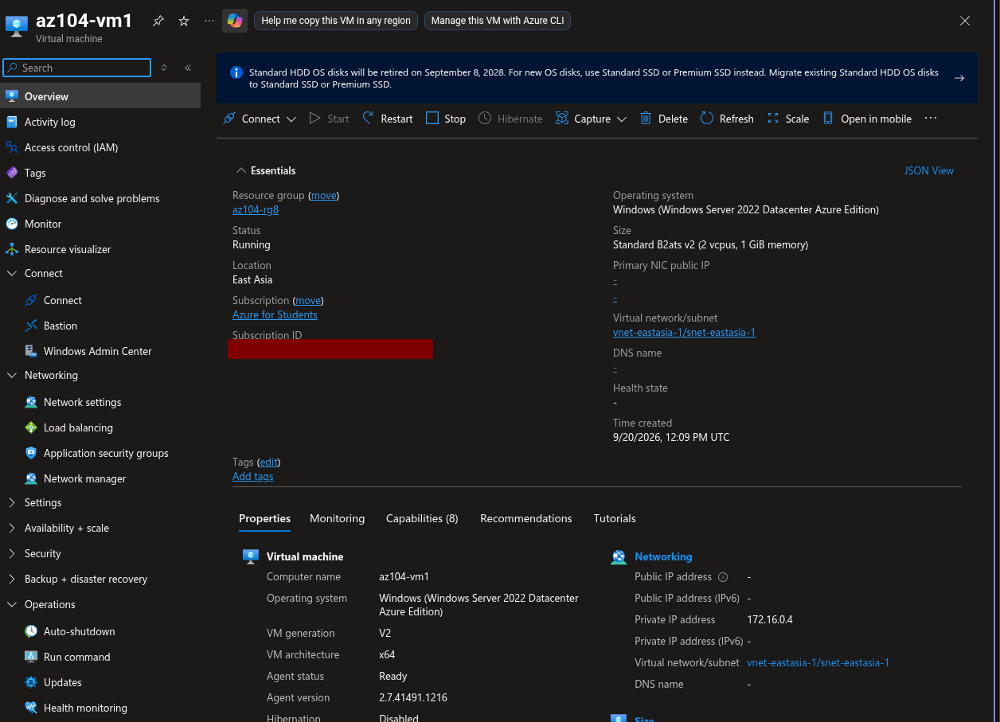

## Task 2: Compute and Storage Scaling

### VM Resize

Stop `az104-vm1` from the Azure portal and wait for:

```text
Stopped (deallocated)
```

Then change its size to a larger available SKU. The official lab uses `Standard_D4s_v5`; this adaptation may use the least expensive supported larger SKU available in East Asia.

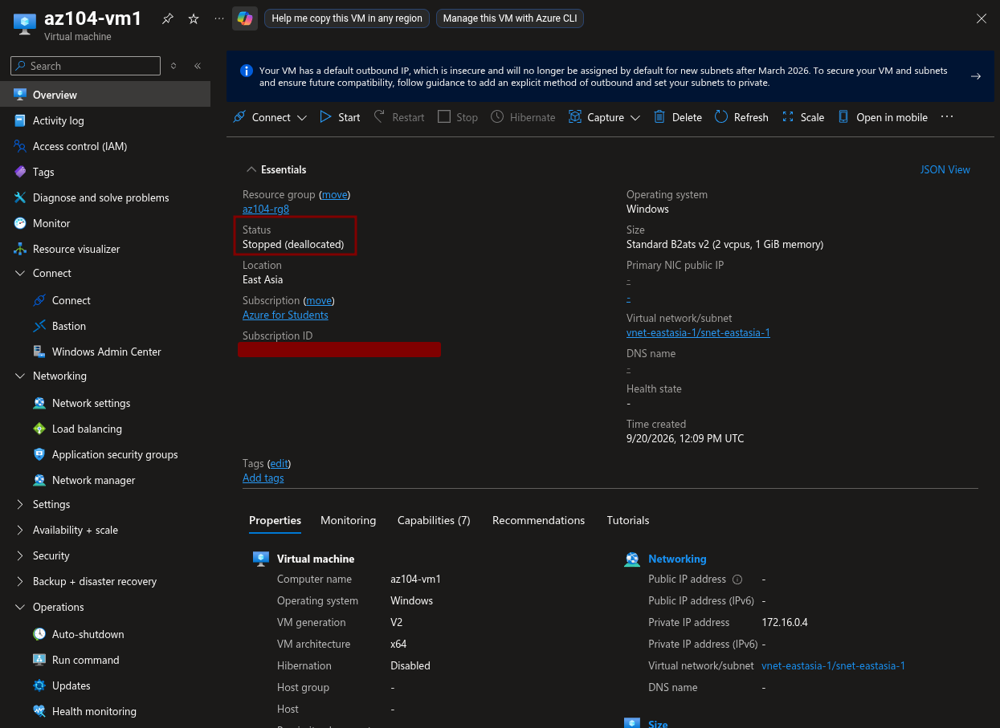

### Data Disk Lifecycle

Create and attach:

```text
Disk name: vm1-disk1
Storage type: Standard HDD LRS
Size: 32 GiB
```

Capture the attached disk state:

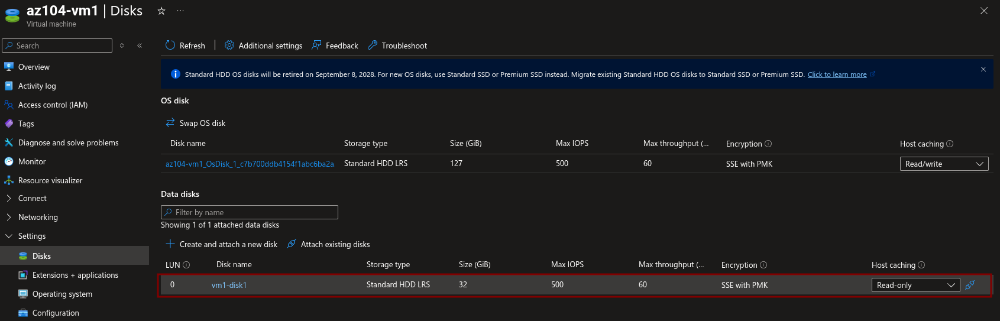

Detach the disk, open the disk resource, and change:

```text
Storage type: Standard SSD LRS
```

Attach the existing disk to `az104-vm1` again and verify its new storage type.

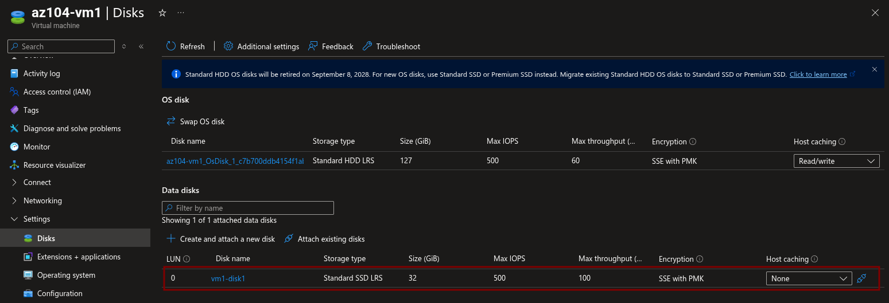

Detaching a disk removes it from the VM but does not delete the disk resource. Delete the resource group during cleanup to avoid retaining storage charges.

## Task 3: Create the VMSS

Create a Uniform VMSS:

```text
Name: vmss1
Resource group: az104-rg8
Region: East Asia
Availability zones: 1, 2, 3 where supported
Orchestration mode: Uniform
Image: Windows Server 2022/2025 Datacenter x64 Gen2
Size: Standard_B2ats_v2 where available
Initial instance count: 1
OS disk: Standard HDD LRS
Azure Spot: Disabled
Boot diagnostics: Disabled
```

### VMSS Networking

Create or use:

```text
VNet: vmss-vnet
Address space: 10.82.0.0/20
Subnet: subnet0
Subnet range: 10.82.0.0/24
```

Create:

```text
NSG: vmss1-nsg
Inbound rule name: allow-http
Source: Any
Source port: *
Destination: Any
Service: HTTP
Action: Allow
Priority: 1010
```

Choose:

```text
Load balancing options: Azure load balancer
Load Balancer: vmss-lb
SKU: Standard
Type: Public
Tier: Regional
Public IP: Standard, static
```

The screenshot shows the VMSS networking configuration with `Azure load balancer` selected and a new `(new) vmss-lb` pending creation.

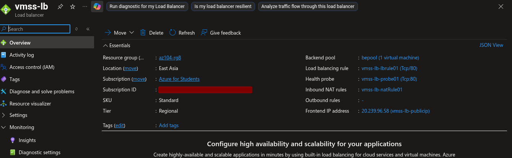

### Review Configuration

Before creating the VMSS, verify:

```text
VMSS name: vmss1
Zones: 1, 2, 3
Size: Standard_B2ats_v2
Instance count: 1
OS disk: Standard HDD LRS
Load balancing: Yes
Load Balancer SKU: Standard
Boot diagnostics: Off
```

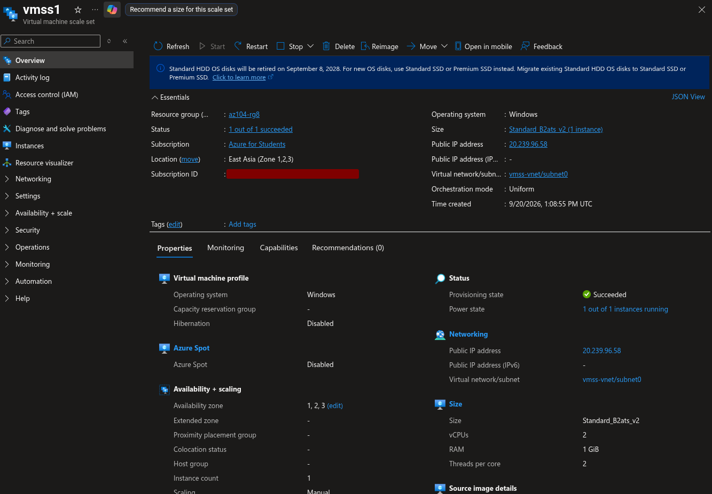

## Task 4: Configure Autoscale

Open:

```text
vmss1 → Availability + scale → Scaling
```

Select:

```text
Custom autoscale
Scale based on a metric
Metric source: Current resource (vmss1)
Metric namespace: Virtual Machine Host
Metric name: Percentage CPU
```

### Scale-Out Rule

Configure:

```text
Operator: Greater than
Threshold: 70
Duration: 10 minutes
Statistic: Average
Operation: Increase percentage by
Percentage: 50
Cooldown: 5 minutes
```

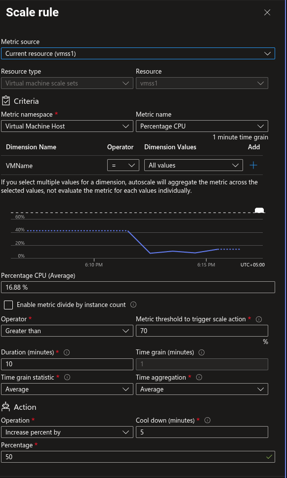

### Scale-In Rule

Configure:

```text
Operator: Less than
Threshold: 30
Duration: 10 minutes
Statistic: Average
Operation: Decrease percentage by
Percentage: 50
Cooldown: 5 minutes
```

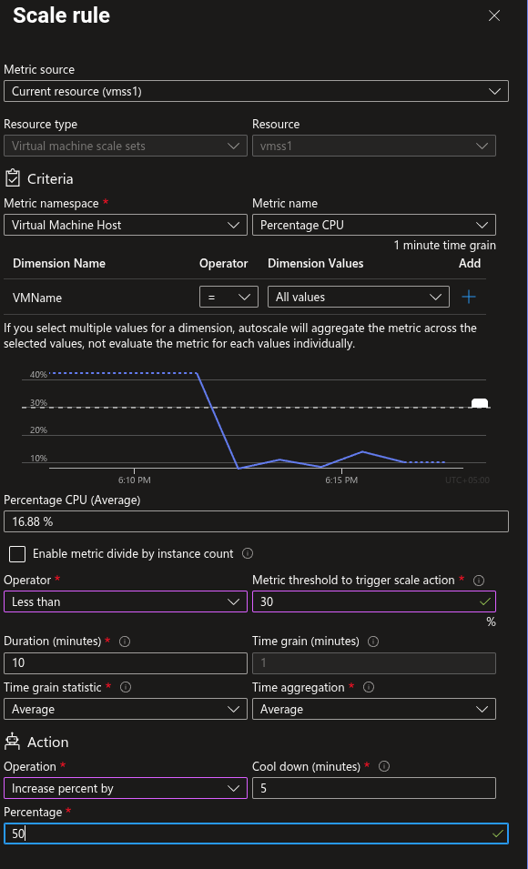

### Instance Limits

Use cost-safe limits:

```text
Minimum: 1
Default: 1
Maximum: 2
```

The official lab uses a maximum of 10, but a maximum of 2 is safer for a student subscription and still proves that autoscale boundaries are configured.

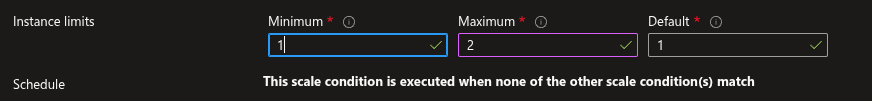

### VMSS Instances

Open the Instances page and verify the current capacity:

```text
Expected initial instances: 1
```

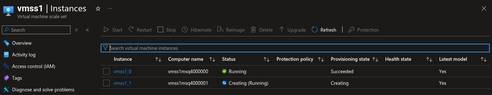

## Optional Tasks

The PowerShell and CLI VM creation tasks are omitted in this cost-optimized implementation. They create additional compute resources without introducing a new core concept after the portal, VM, VMSS, and autoscale exercises.

## Evidence Directory

```text
06-compute-management/
├── lab-08-manage-virtual-machines.md
└── lab-08-screenshots/
    ├── 01-zone-resilient-windows-vms.png
    ├── 02-vm1-resize-deallocated.png
    ├── 03-data-disk-attached-standard-hdd.png
    ├── 04-data-disk-standard-ssd-reattached.png
    ├── 05-vmss-overview-and-zones.png
    ├── 06-vmss-networking-load-balancer-nsg.png
    ├── 07-vmss-scale-out-cpu-rule.png
    ├── 08-vmss-scale-in-cpu-rule.png
    ├── 09-vmss-instance-limits.png
    ├── 10-vmss-instances.png
    └── 11-compute-management-resource-topology.png
```

## Full Topology Evidence

Use Azure Resource Visualizer for the final architecture screenshot:

```text
Resource groups → az104-rg8 → Resource visualizer
```

The topology should show the standalone VMs, disks, VMSS, VMSS networking, NSG, Load Balancer, and public IP. Save the screenshot as:

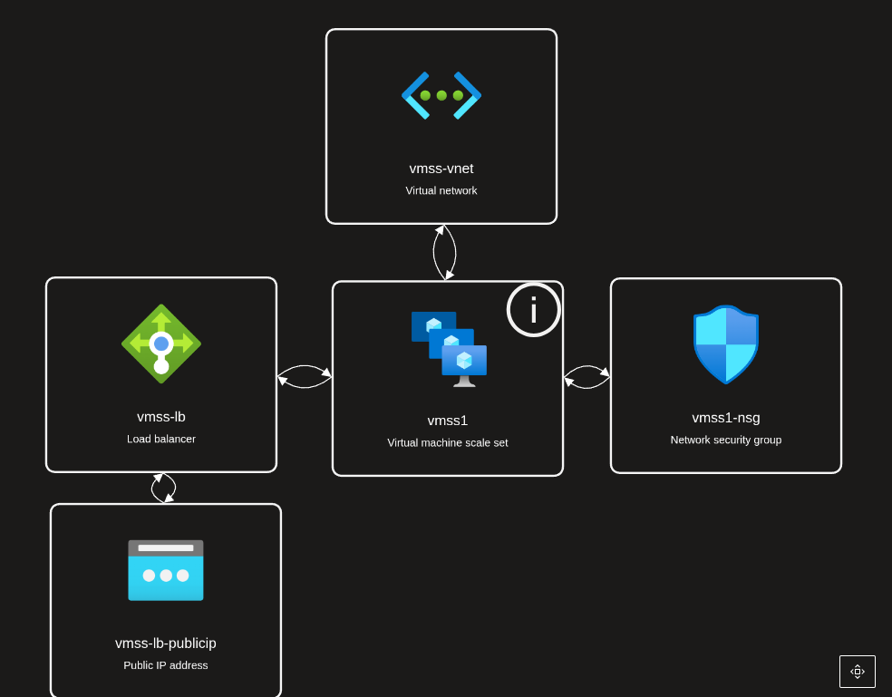

## Troubleshooting

### No multi-zone checkbox

Create the two standalone VMs in separate portal operations. Select Zone 2 for `az104-vm1` and Zone 1 for `az104-vm2`.

### VMSS Load Balancer SKU is unclear

Open the Load Balancer resource after deployment and verify:

```text
SKU: Standard
Type: Public
Tier: Regional
```

Also verify the associated public IP is Standard and static.

### VMSS cannot deploy to all zones

The selected VM size or region may not support all three zones. Use the smallest zone-supported SKU available, or document the regional/SKU limitation.

### Autoscale creates more VMs than expected

Use:

```text
Minimum: 1
Default: 1
Maximum: 2
```

Do not use a maximum of 10 in this student subscription adaptation.

## Cleanup

After saving all screenshots, delete the complete lab resource group:

```bash
az group delete --name az104-rg8 --yes --no-wait
```

This removes the standalone VMs, VMSS, disks, NICs, NSG, VNet, Load Balancer, public IP, and autoscale configuration.

## Expected Outcome

The lab demonstrates zonal VM placement, compute resizing, managed-disk performance changes, VM Scale Sets, public Standard Load Balancer integration, and CPU-based autoscaling while minimizing unnecessary Azure credit consumption.
