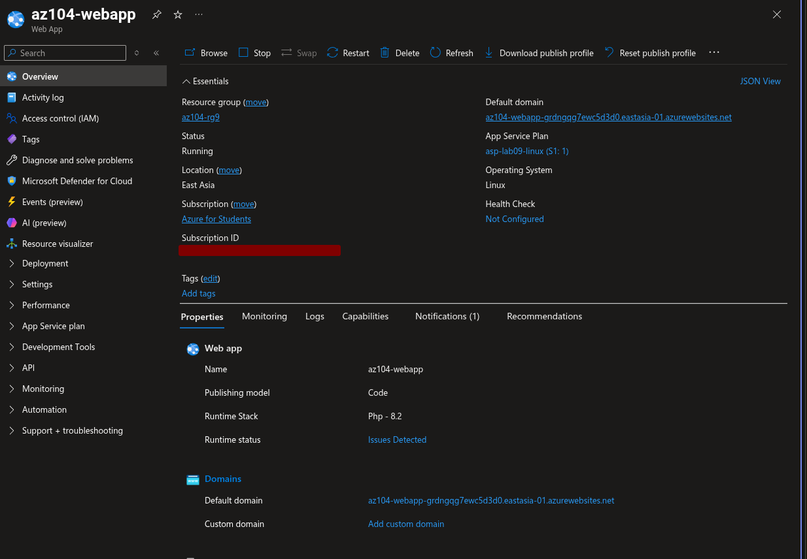
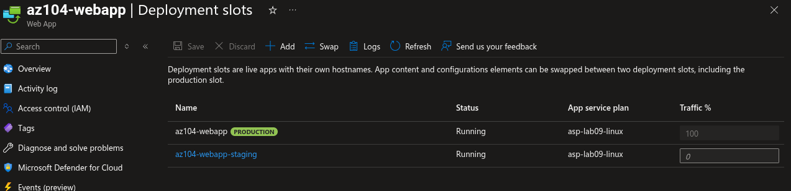
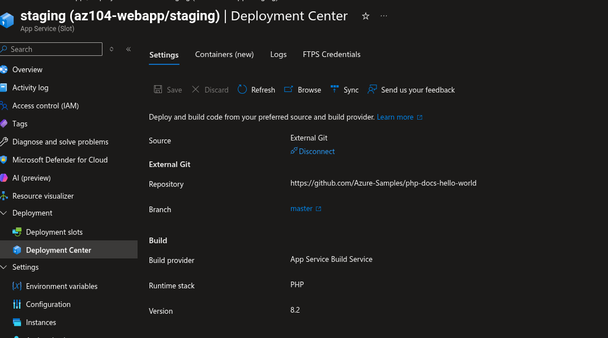
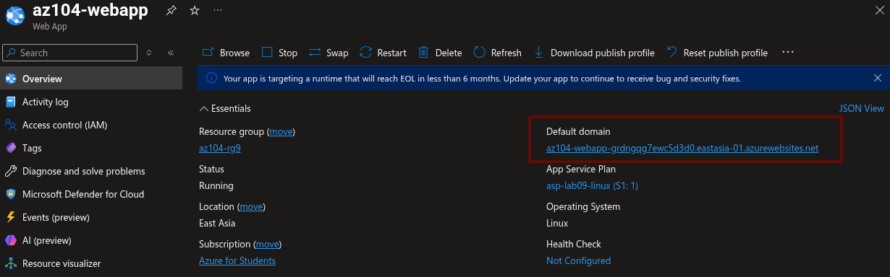
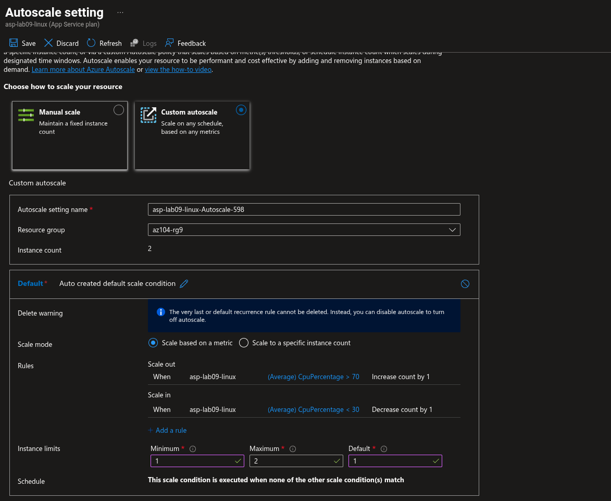

# Lab 09a: Cost-Optimized Azure Web Apps

## Overview

This lab deployed a PHP web application to Azure App Service, created a staging deployment slot, configured external Git deployment, swapped the validated staging application into production, configured scale-out settings, and created an Azure Load Testing resource.

The lab was completed as a cost-optimized adaptation of the original AZ-104 exercise. The original instructions specify a Premium V3 App Service plan. This implementation used a Standard S1 Linux App Service plan because it supports the required staging-slot and autoscale concepts at a lower hourly cost.

All temporary resources were deleted after the lab to minimize Azure credit consumption.

## Objectives

- Deploy a Linux PHP Azure Web App.
- Use an App Service Plan that supports deployment slots.
- Create a staging slot without cloning production settings.
- Deploy a Hello World PHP application from an external Git repository.
- Validate the application in the staging slot.
- Swap the staging slot into production.
- Configure App Service scale-out settings.
- Create an Azure Load Testing resource and configure a minimal test plan.
- Capture architecture and testing evidence.
- Delete the temporary lab resources.

## Architecture

```text
                            Internet
                               |
                               v
             Production Web App: az104-webapp
             PHP 8.2 on Linux / Standard S1 Plan
                               |
                     Production deployment slot
                               |
                    Swap validated staging code
                               |
                               v
                Staging slot: az104-webapp/staging
                External Git deployment source
                Azure-Samples/php-docs-hello-world
                               |
                               v
                     Hello World PHP application

                  App Service Plan: asp-lab09-linux
                  Linux / Standard S1
                  Supports deployment slots and scale-out

                  Azure Load Testing: testingloadonweb
                  Minimal test configuration:
                  1 engine, 1 concurrent user, 1 minute
```

## Resource Inventory

| Resource | Name | Configuration |
|---|---|---|
| Resource group | `az104-rg9` | Temporary lab resource group; deleted after lab |
| Production web app | `az104-webapp` | PHP 8.2, Linux |
| Staging slot | `az104-webapp/staging` | Created without cloning settings |
| App Service Plan | `asp-lab09-linux` | Standard S1 Linux |
| Deployment source | `Azure-Samples/php-docs-hello-world` | External Git repository |
| Load Testing resource | `testingloadonweb` | Azure Load Testing |
| Load-test target | Production slot | HTTPS default domain |

## Cost Optimization

The original lab specifies Premium V3 P1V3. The selected plan was Standard S1 because it is lower cost while supporting the lab requirements:

```text
Runtime: PHP 8.2
Operating system: Linux
App Service tier: Standard S1
Deployment slots: Supported
Slot swapping: Supported
Rules-based scaling: Supported
```

The environment was kept small:

```text
Minimum instances: 1
Maximum instances: 2
Load-test engines: 1
Concurrent users per engine: 1
Test duration: 1 minute
```

The resource group was deleted after screenshots were captured. App Service Plans continue to incur charges while they exist, even if the web app receives no traffic.

## Task 1: Create Web App

The web application was configured with:

```text
Resource group: az104-rg9
Publish: Code
Runtime stack: PHP 8.2
Operating system: Linux
Region: East Asia
App Service Plan: asp-lab09-linux
Pricing tier: Standard S1
```

Standard S1 was selected instead of Premium V3 P1V3 as a cost-conscious substitution. Standard is sufficient for staging deployment slots, slot swaps, and scale-out configuration.

## Task 2: Deployment Slot

A staging slot was created:

```text
Name: staging
Clone settings from: Do not clone settings
```

The staging slot uses a separate hostname from production and provides a safe location to validate a release before swapping it into the production slot.

## Task 3: External Git Deployment

On the staging slot, SCM Basic Authentication publishing credentials were enabled and the deployment source was configured:

```text
Source: External Git
Repository: https://github.com/Azure-Samples/php-docs-hello-world
Branch: master
```

The deployed staging site was expected to display a Hello World page.

## Task 4: Slot Swap

The staging slot was swapped into production after validation:

```text
Source: staging
Target: production
```

This demonstrates a staged deployment workflow: deploy and validate in staging, then promote the tested code to production through a slot swap.

## Task 5: Scale-Out and Load Testing

The production App Service Plan was configured with cost-safe scale-out values:

```text
Minimum instances: 1
Maximum burst / maximum instances: 2
```

An Azure Load Testing resource named `testingloadonweb` was created. A minimal URL-based load test was configured for the production app:

```text
Engine instances: 1
Load pattern: Linear
Concurrent users per engine: 1
Test duration: 1 minute
Ramp-up time: 1 minute
```

The portal displayed a persistent loading state while resolving the selected Load Testing resource during test creation. The test was not run, and no duplicate resources were created. The resource topology and configured test-plan review were captured as evidence before the resource group was deleted.

## Evidence

Store screenshots in:

```text
07-app-service/lab-09a-screenshots/
```

### Suggested Evidence Set

```text
07-app-service/
├── lab-09a-implement-web-apps.md
└── lab-09a-screenshots/
    ├── 01-web-app-and-standard-s1-plan.png
    ├── 02-deployment-slots-production-staging.png
    ├── 03-staging-external-git-deployment-center.png
    ├── 04-staging-hello-world.png
    ├── 05-slot-swap-completed.png
    ├── 06-production-hello-world-after-swap.png
    ├── 07-app-service-autoscale-settings.png
    ├── 08-load-test-live-metrics.jpg
    └── 09-web-app-resource-topology.jpg
```

### Load Test Configuration

The load-test configuration was captured before running the test. The screenshot shows a validated minimal configuration but does not prove that the test executed or that live metrics were produced.


### App Service Topology

Azure Resource Visualizer shows the relationship among the App Service Plan, production web app, staging slot, and Azure Load Testing resource.


## Screenshot Placeholders

Add the following image references only if the matching screenshots were captured and saved with these exact names:

```markdown











```

## Learning Outcomes

This lab demonstrated:

- Azure App Service as a PaaS web-hosting service.
- PHP web application hosting on Linux.
- App Service Plan tiers and their feature/cost trade-offs.
- Deployment slots for pre-production validation.
- External Git deployment.
- Staging-to-production slot swaps.
- Basic scale-out configuration with a controlled maximum capacity.
- Azure Load Testing resource and URL-based test-plan configuration.
- Resource topology visualization.

## Cleanup

All Lab 09a resources were deleted after evidence capture to avoid ongoing charges.

Cleanup command:

```bash
az group delete --name az104-rg9 --yes --no-wait
```

Deletion removes the web app, staging slot, App Service Plan, Azure Load Testing resource, and associated lab resources.

## Notes

- No SAS tokens, publishing credentials, passwords, or connection strings are included in this documentation.
- The Load Testing test run was not completed because the portal remained in a loading state during test creation.
- The configured Load Testing resource and its test-plan review provide evidence of the intended minimal load-test setup.
- The App Service Plan and staging slot are no longer deployed because the lab resource group was deleted.
