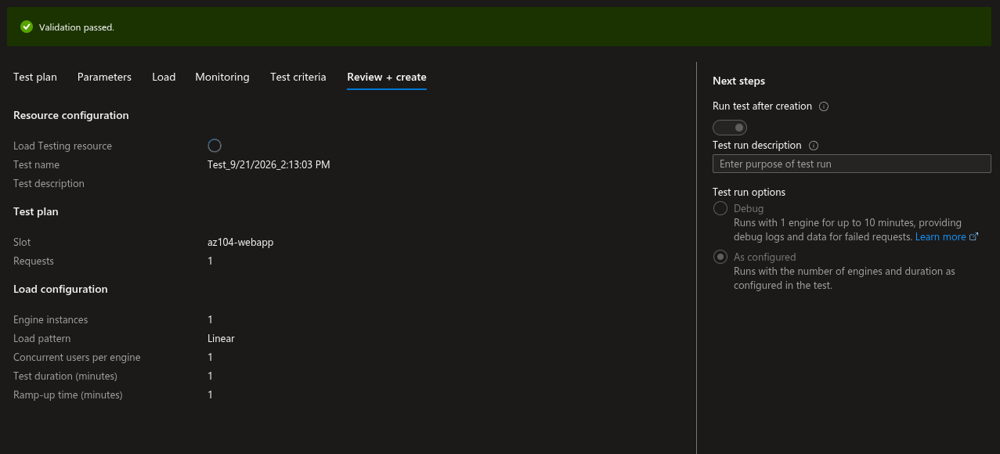
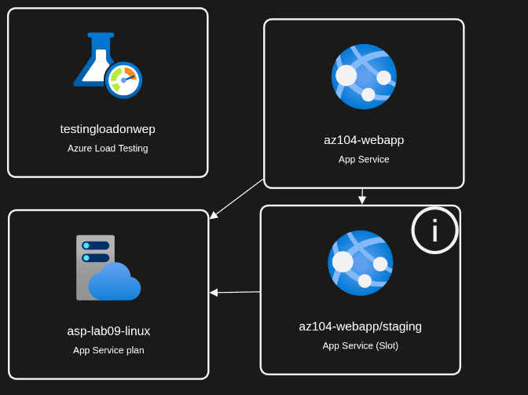

# Lab 09a: Cost-Optimized Azure Web Apps

## Overview

This lab deployed a PHP web application to Azure App Service, created a staging slot, configured external Git deployment, swapped staging into production, configured scale-out settings, and created an Azure Load Testing resource.

The original lab specifies Premium V3. This implementation used a Standard S1 Linux App Service Plan to reduce cost while preserving the deployment-slot and scaling objectives.

All temporary resources were deleted after evidence capture.

## Architecture

```text
                         Internet
                            |
                            v
                  az104-webapp
                  Production slot
                  PHP 8.2 / Linux
                            |
                         Slot swap
                            |
                            v
                  az104-webapp/staging
                  Staging deployment slot
                            |
                            v
             External Git: Azure-Samples/php-docs-hello-world
                            |
                            v
                       Hello World

                 Shared App Service Plan
                     asp-lab09-linux
                     Standard S1 Linux

                 testingloadonweb
                 Azure Load Testing resource
                 Test was not created or executed
```

## Resource Inventory

| Resource | Name | Configuration |
|---|---|---|
| Resource group | `az104-rg9` | Temporary lab group; deleted after completion |
| Web app | `az104-webapp` | PHP 8.2, Linux |
| Deployment slot | `staging` | Created without cloning settings |
| App Service Plan | `asp-lab09-linux` | Standard S1 Linux |
| Load Testing resource | `testingloadonweb` | Created; test creation remained loading |

## Cost-Optimized Configuration

```text
App Service Plan: Standard S1 Linux
Minimum instances: 1
Maximum instances: 2
Load-test engines: Not deployed for a run
```

Standard S1 was selected instead of Premium V3 P1V3. It is sufficient for the App Service deployment slot, slot swap, external Git deployment, and scale-out exercises.

## Task 1: Create the Web App

The production web app was configured with:

```text
Resource group: az104-rg9
Publish: Code
Runtime stack: PHP 8.2
Operating system: Linux
Region: East Asia
App Service Plan: asp-lab09-linux
Pricing tier: Standard S1
```

## Task 2: Create the Staging Slot

A deployment slot named `staging` was created without cloning production settings.

The two deployment endpoints were:

```text
Production: https://az104-webapp.azurewebsites.net
Staging: https://az104-webapp-staging.azurewebsites.net
```

The actual hostname may vary if the app name was changed for global uniqueness.

## Task 3: Configure External Git Deployment

The staging slot was configured to use:

```text
Source: External Git
Repository: https://github.com/Azure-Samples/php-docs-hello-world
Branch: master
```

The staging application displayed the Hello World page after deployment.

## Task 4: Swap Deployment Slots

The staging slot was swapped into production:

```text
Source: staging
Target: production
```

The production slot then displayed the validated Hello World application.

## Task 5: Scale-Out Configuration

The production App Service Plan used cost-safe scaling limits:

```text
Minimum instances: 1
Maximum instances: 2
```

These limits demonstrate scale-out without allowing the lab to create a large number of paid instances.

## Load Testing Result

An Azure Load Testing resource named `testingloadonweb` was created. When creating the test, the portal remained stuck in a loading state while resolving the resource configuration.

The test was therefore:

- Not created a second time.
- Not executed.
- Not represented as completed live metrics.

The test resource was not used for a load run. This was intentional to avoid duplicate resources and unnecessary charges.

## Evidence Directory

The screenshots are stored in:

```text
07-app-service/lab-09a-screenshots/
```

The Markdown file is stored in the parent directory:

```text
07-app-service/lab-09a-implement-web-apps.md
```

Because the Markdown file and screenshot folder are siblings, every image path must be exactly:

```markdown

```

Do not add `./07-app-service/` to the image path. That would incorrectly repeat the parent directory.

## Screenshots

### Web App and Plan


### Deployment Slots


### External Git Deployment


### Staging Hello World


### Slot Swap


### Production After Swap


### Autoscale Settings


### Load Test Configuration

The existing filename is `08-load-test-live-metrics.png`, but the test did not run. This screenshot should be described as a load-test configuration or review screen, not live metrics.



### Resource Topology



## Screenshot Directory

```text
07-app-service/
├── lab-09a-implement-web-apps.md
└── lab-09a-screenshots/
    ├── 01-web-app-and-standard-s1-plan.png
    ├── 02-deployment-slots-production-staging.png
    ├── 03-staging-external-git-deployment-center.png
    ├── 04-staging-hello-world.png
    ├── 05-slot-swap-completed.png
    ├── 06-production-hello-world-after-swap.png
    ├── 07-app-service-autoscale-settings.png
    ├── 08-load-test-live-metrics.png
    └── 09-web-app-resource-topology.png
```

## Troubleshooting Note

The Load Testing create page remained in a loading state. Since the test was not created or executed, no live metrics or completed test result is claimed. The resource topology still documents that an Azure Load Testing resource existed during the lab.

## Cleanup

The full resource group was deleted after evidence capture:

```bash
az group delete --name az104-rg9 --yes --no-wait
```

This removed the App Service, staging slot, App Service Plan, Azure Load Testing resource, and related lab resources.

## Learning Outcome

This lab demonstrates Azure App Service as a PHP PaaS platform, deployment slots, external Git deployment, blue-green-style slot swapping, cost-safe scale-out configuration, and Azure Load Testing resource creation. The load-test execution portion was intentionally not completed because the portal remained stuck while creating the test.
