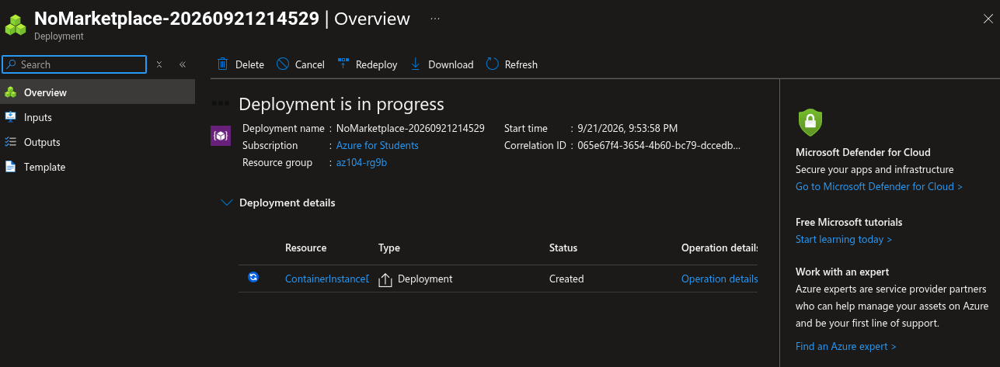

# Lab 09b: Implement Azure Container Instances

## Overview

This lab demonstrates how to deploy and verify a Linux container using Azure Container Instances (ACI). The deployment uses the Microsoft quickstart Hello World image and exposes it through a public DNS name over HTTP port 80.

The lab was performed as a short, cost-conscious exercise. The container was validated through its public FQDN and container logs, and the lab resources were removed after evidence capture.

## Objectives

- Deploy an Azure Container Instance from a Docker image.
- Configure public HTTP access through a DNS name label.
- Verify the container is running.
- Test the application through its public FQDN.
- Review HTTP GET entries in the container logs.
- Capture the Azure resource topology.
- Delete all temporary resources after validation.

## Architecture

```text
                             Internet browser
                                    |
                                    | HTTP / TCP 80
                                    v
       <dns-label>.<region>.azurecontainer.io
                                    |
                                    v
                    Azure Container Instance
                              az104-c1
                                    |
                                    v
       mcr.microsoft.com/azuredocs/aci-helloworld:latest
                                    |
                                    v
                 Welcome to Azure Container Instance
                                    |
                                    v
                         Container HTTP logs
```

## Resource Inventory

| Resource | Value |
|---|---|
| Resource group | `az104-rg9` or the resource group used during deployment |
| Container name | `az104-c1` |
| Operating system | Linux |
| Image source | Quickstart images |
| Container image | `mcr.microsoft.com/azuredocs/aci-helloworld:latest` |
| Public protocol | HTTP |
| Public port | 80 |
| DNS | Globally unique DNS name label |
| Monitoring logs | Disabled to avoid extra Log Analytics usage |
| Region | East Asia or another available region |

## Deployment Configuration

The container instance was configured with:

```text
Image source: Quickstart images
Image: mcr.microsoft.com/azuredocs/aci-helloworld:latest
Operating system: Linux
Container name: az104-c1
Public networking: Enabled
Protocol: TCP
Port: 80
DNS name label: Globally unique label
Container instance logs: Disabled
```

The DNS label creates an FQDN similar to:

```text
<dns-label>.<region>.azurecontainer.io
```

The exact FQDN must be copied from the Azure Container Instance Overview page because the region and label are deployment-specific.

## Task 1: Deploy the Container Instance

In the Azure portal, open:

```text
Container instances → Create
```

Use the resource group and container name shown in the Resource Inventory table. Choose the Linux Hello World quickstart image and configure public HTTP port 80.

On the Monitoring page, keep container instance logs disabled for this short lab. Built-in container logs can still be viewed from the resource’s **Containers → Logs** blade after deployment.

## Task 2: Verify the Deployment

After deployment:

1. Open the container instance resource.
2. Confirm the status is:
   
   ```text
   Running
   ```

3. Copy the FQDN from Overview.
4. Open the FQDN in a browser using HTTP.
5. Confirm the page displays:
   
   ```text
   Welcome to Azure Container Instance
   ```

6. Refresh the page several times.
7. Open:
   
   ```text
   Containers → Logs
   ```

8. Verify that HTTP GET entries were generated by the browser requests.

## Evidence

The screenshots are stored in:

```text
07-app-service/lab-09b-screenshots/
```

The Markdown file is stored in the parent directory:

```text
07-app-service/lab-09b-implement-azure-container-instances.md
```

Because the Markdown file and screenshot directory are siblings, use this exact image syntax:

```markdown

```

Do not prefix the path with `07-app-service/`; that would repeat the parent directory.

### Running Container and FQDN


### Hello World Application


### Container HTTP Logs


### Resource Topology


### Additional Deployment Evidence

The screenshot directory also contains an additional timestamped image:

```text
2026-09-21_21-55.png
```

If this image documents the deployment or configuration, embed it with:

```markdown

```

## Evidence Directory

```text
07-app-service/
├── lab-09a-implement-web-apps.md
├── lab-09a-screenshots/
└── lab-09b-implement-azure-container-instances.md
    └── lab-09b-screenshots/
        ├── 02-aci-overview-running-fqdn.png
        ├── 03-aci-hello-world-page.png
        ├── 04-aci-container-http-logs.png
        ├── 05-aci-resource-topology.png
        └── 2026-09-21_21-55.png
```

## Cost Control

Azure Container Instances uses per-second billing based on the vCPU and memory requested by the container group. The container should not be left running after the lab. No Log Analytics workspace was enabled, and no additional monitoring services were deployed.

Use a small quickstart container, perform the browser and log tests, capture evidence, and delete the resource group immediately afterward.

## Troubleshooting

### Container is not Running

Check the Container Instance Overview and Events pages. Confirm that the image name is correct and that the region can pull the image.

### FQDN does not open

Check that:

- The container status is Running.
- The DNS name label is globally unique.
- HTTP port 80 is exposed.
- The URL uses the exact FQDN shown in Overview.
- The browser uses `http://`, not an incorrect custom hostname.

### Logs are empty

Refresh the application page several times, wait briefly, and refresh the Logs blade. Confirm that container instance logs were not redirected to an unavailable Log Analytics workspace.

## Cleanup

After saving all screenshots, delete the resource group used for this lab:

```bash
az group delete --name az104-rg9 --yes --no-wait
```

If you used a separate resource group such as `az104-rg9b`, delete that name instead:

```bash
az group delete --name az104-rg9b --yes --no-wait
```

Deleting the complete resource group removes the container instance and prevents continued container compute charges.

## Expected Outcome

The lab demonstrates a lightweight serverless container deployment using Azure Container Instances. The container runs a public Hello World web application, responds through a generated DNS name, and records HTTP GET activity in its container logs.
