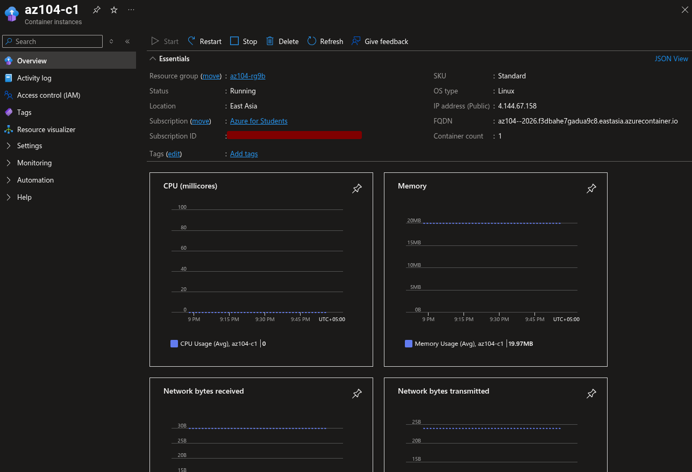
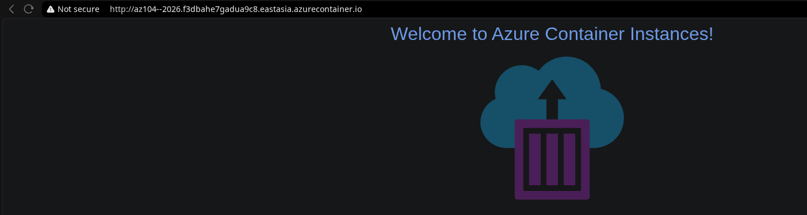
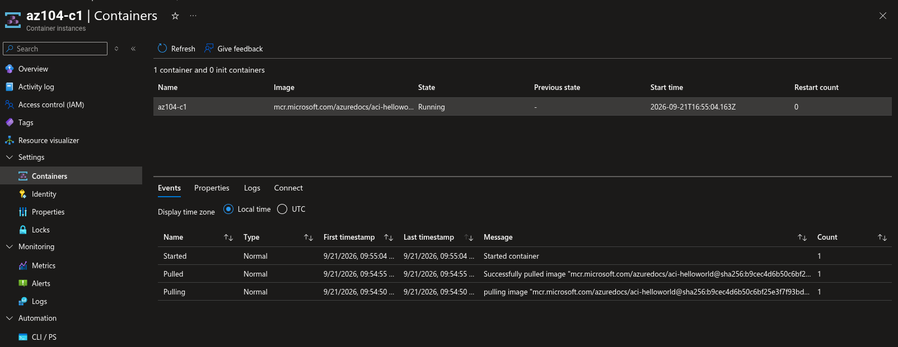
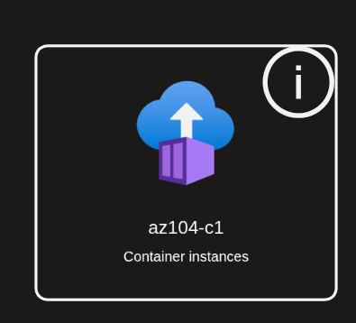

# Lab 09b: Implement Azure Container Instances

## Overview

This lab demonstrates the deployment of a Linux container using Azure Container Instances (ACI). The container uses Microsoft’s quickstart Hello World image and exposes a public HTTP endpoint through an Azure-generated DNS name.

The lab was completed as a short, cost-conscious exercise. The container was validated through its public FQDN, application response, container logs, and resource topology. Temporary resources were removed after evidence capture.

## Objectives

- Deploy an Azure Container Instance from a Docker image.
- Configure public HTTP access on port 80.
- Assign and validate a public DNS name label.
- Confirm the container is Running.
- Open the Hello World application.
- Review HTTP GET entries in container logs.
- Capture Azure Resource Visualizer evidence.
- Delete the temporary resource group after validation.

## Architecture

```text
                         Internet browser
                                |
                                | HTTP / TCP 80
                                v
       <dns-label>.<region>.azurecontainer.io
                                |
                                v
                    Azure Container Instance
                              az104-c1
                                |
                                v
       mcr.microsoft.com/azuredocs/aci-helloworld:latest
                                |
                                v
              Welcome to Azure Container Instance
                                |
                                v
                     HTTP GET container logs
```

## Resource Inventory

| Resource | Configuration |
|---|---|
| Resource group | The temporary group used for Lab 09b |
| Container instance | `az104-c1` |
| Operating system | Linux |
| Image source | Quickstart images |
| Image | `mcr.microsoft.com/azuredocs/aci-helloworld:latest` |
| Public protocol | HTTP |
| Public port | 80 |
| DNS | Globally unique DNS name label |
| Container instance logs | Disabled during deployment |

## Deployment

The container instance was configured with:

```text
Image source: Quickstart images
Image: mcr.microsoft.com/azuredocs/aci-helloworld:latest
Operating system: Linux
Container name: az104-c1
Public networking: Enabled
Protocol: TCP
Port: 80
DNS name label: Globally unique label
Container instance logs: Disabled
```

The application FQDN was copied from the Container Instance Overview page after deployment. The exact FQDN is deployment-specific and is intentionally not hard-coded in this document.

## Verification

After deployment, the following checks were completed:

1. Container status showed `Running`.
2. The public FQDN opened in a browser.
3. The page displayed the Azure Container Instance Hello World application.
4. The page was refreshed to generate HTTP requests.
5. The Containers → Logs blade showed HTTP GET entries.
6. Azure Resource Visualizer displayed the deployed container resource.

## Evidence

The screenshots are stored in:

```text
07-app-service/lab-09b-screenshots/
```

This Markdown file is stored in the parent directory:

```text
07-app-service/lab-09b-implement-azure-container-instances.md
```

Because the Markdown file and screenshot directory are siblings, all image references use this exact format:

```markdown

```

### Deployment Review


### Running Status and FQDN



### Hello World Application



### Container HTTP Logs



### Resource Topology



## Evidence Directory

```text
07-app-service/
├── lab-09a-implement-web-apps.md
├── lab-09a-screenshots/
├── lab-09b-implement-azure-container-instances.md
├── lab-09b-screenshots/
│   ├── 01-aci-overview-and-create.png
│   ├── 02-aci-overview-running-fqdn.png
│   ├── 03-aci-hello-world-page.png
│   ├── 04-aci-container-http-logs.png
│   └── 05-aci-resource-topology.png
├── lab-09c-implement-container-apps.md
└── lab-09c-screenshots/
```

## Cost Control

The quickstart container was used with minimal resources. Container instance logs were not connected to Log Analytics. The application was tested briefly and the resource group was deleted afterward.

Azure Container Instances charges according to allocated vCPU and memory while the container group runs. Deleting the resource group prevents the container from continuing to incur compute charges.

## Troubleshooting

### The container is not Running

Review the container Events page and confirm that the image name is correct and available in the selected region.

### The FQDN does not open

Confirm that:

- The container status is Running.
- The DNS label is globally unique.
- TCP port 80 is exposed.
- The exact FQDN from Overview is being used.
- The browser uses `http://`.

### Logs are empty

Refresh the application page multiple times, wait briefly, and refresh the Logs blade. HTTP GET entries are generated only after requests reach the container.

## Cleanup

After evidence capture, delete the complete resource group used for the lab:

```bash
az group delete --name <lab-09b-resource-group> --yes --no-wait
```

Replace `<lab-09b-resource-group>` with the exact resource-group name shown in the Azure portal. Deleting the full group removes the container instance and prevents continued charges.

## Expected Outcome

The lab demonstrates a lightweight container deployment using Azure Container Instances. The container runs a public Hello World web application, responds through a generated DNS name, records HTTP GET activity in its logs, and is removed after validation.
