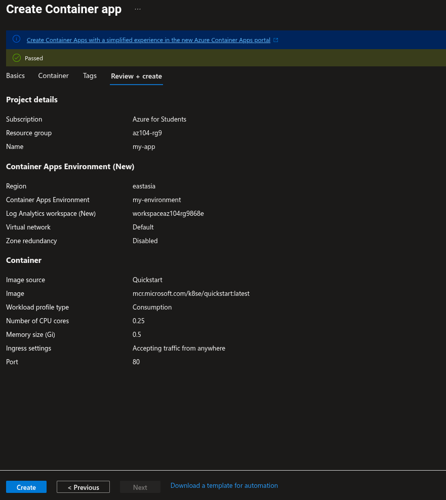
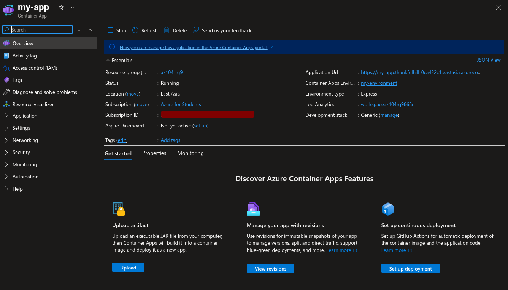
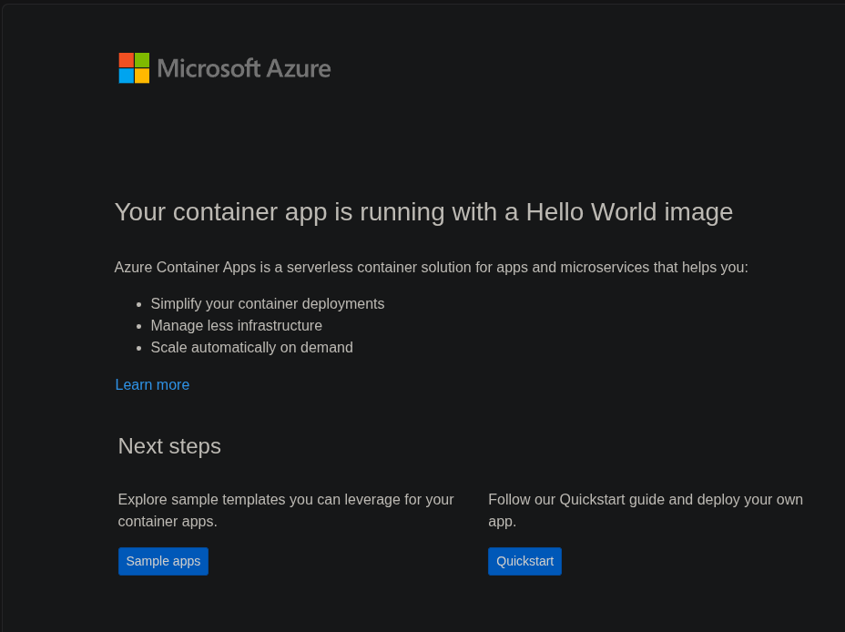
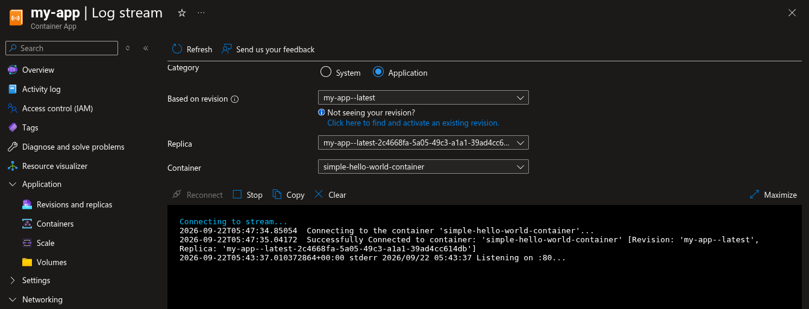
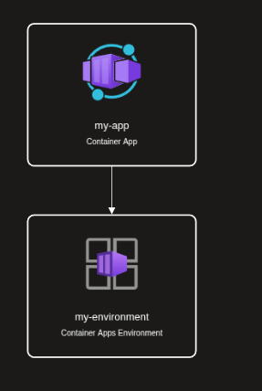

# Lab 09c: Implement Azure Container Apps

## Overview

This lab demonstrates the deployment of a simple containerized web application using Azure Container Apps. Azure Container Apps provides a managed application platform for containers without requiring direct management of a Kubernetes cluster.

The lab uses a Consumption environment and the quickstart Hello World image to minimize cost. The application is exposed through external HTTP ingress, tested through its generated application URL, and documented with Azure Resource Visualizer evidence.

## Objectives

- Create an Azure Container Apps environment.
- Deploy a Container App using the Simple Hello World quickstart image.
- Configure external application ingress on port 80.
- Verify the generated application URL.
- Confirm the Hello World response.
- Capture the managed environment and application topology.
- Delete temporary resources after validation.

## Architecture

```text
                         Internet browser
                                |
                                | External HTTP/HTTPS ingress
                                v
                    Azure Container App: my-app
                                |
                                v
                  Simple Hello World container
                                |
                                v
             Managed Container Apps Environment
                    Name: my-environment
                    Workload: Consumption
                                |
                                v
           Azure-managed serverless container platform
           No Kubernetes cluster administration required
```

## Resource Inventory

| Resource | Configuration |
|---|---|
| Resource group | The temporary group used for Lab 09c |
| Container App | `my-app` or a unique equivalent |
| Container Apps Environment | `my-environment` |
| Region | East Asia or another available region |
| Workload profile | Consumption |
| Container image | Simple Hello World quickstart image |
| Ingress | External |
| Target port | 80 |

## Cost-Optimized Configuration

The environment uses the Consumption workload profile rather than a dedicated workload profile. This is appropriate for a short demonstration because the application can scale according to demand and does not require dedicated reserved compute.

Avoid adding the following resources for this lab:

```text
Dedicated workload profiles
Private endpoints
Custom domains
Virtual network integration
Dapr components
Additional replicas
Log Analytics retention beyond defaults
```

The application was deployed only long enough to validate the public URL and capture evidence.

## Task 1: Create the Container App

Create an Azure Container App with:

```text
Container app name: my-app
Container Apps Environment: Create new
Environment name: my-environment
Region: East Asia
Workload profile: Consumption
Use quickstart image: Enabled
Quickstart image: Simple hello world container
```

Under Application ingress settings, configure:

```text
Ingress: Enabled
Ingress visibility: External
Target port: 80
Transport: Auto
```

Then select **Review + create** and **Create**.

## Task 2: Verify Deployment

After deployment:

1. Select **Go to resource**.
2. Copy the value beside **Application URL**.
3. Open the URL in a browser.
4. Confirm the message:

```text
Your container app is running with a Hello World image
```

The exact application URL is deployment-specific and is intentionally not hard-coded in this document.

## Evidence

The screenshots are stored in:

```text
07-app-service/lab-09c-screenshots/
```

This Markdown file is stored in the parent directory:

```text
07-app-service/lab-09c-implement-container-apps.md
```

Because the Markdown file and screenshot directory are siblings, use this exact GitHub-compatible syntax:

```markdown

```

### Container App Review



### Running App and Application URL



### Hello World Page



### Environment Logs and Runtime Evidence



### Resource Topology



## Evidence Directory

```text
07-app-service/
├── lab-09a-implement-web-apps.md
├── lab-09a-screenshots/
├── lab-09b-implement-azure-container-instances.md
├── lab-09b-screenshots/
├── lab-09c-implement-container-apps.md
└── lab-09c-screenshots/
    ├── 01-container-app-review-and-create.png
    ├── 02-container-app-overview-running-url.png
    ├── 03-container-app-hello-world-page.png
    ├── 04-container-app-environment-log-stream.png
    └── 05-container-app-resource-topology.png
```

## ACI and ACA Comparison

| Service | Primary use |
|---|---|
| Azure Container Instances | Run an individual container or simple container group quickly |
| Azure Container Apps | Run application containers with managed ingress, revisions, scaling, and platform features |
| Azure Kubernetes Service | Run Kubernetes workloads with significantly more cluster and platform responsibility |

This lab uses Container Apps to demonstrate an application-focused managed container platform rather than a single standalone container deployment.

## Troubleshooting

### Application URL is unavailable

Confirm that:

- The Container App provisioning state is successful.
- External ingress is enabled.
- The target port is 80.
- The quickstart image is selected.
- The environment provisioning is complete.

### Hello World response is missing

Refresh the application URL after the first revision becomes ready. Check the Container App Revision and Replicas pages if the application remains unavailable.

### Environment is more expensive than expected

Check that the environment uses Consumption rather than a Dedicated workload profile. Remove unnecessary replicas, diagnostics, private endpoints, and networking integrations.

## Cleanup

After saving all evidence, delete the complete resource group used for Lab 09c:

```bash
az group delete --name <lab-09c-resource-group> --yes --no-wait
```

Replace `<lab-09c-resource-group>` with the exact resource-group name used in the portal. Deleting the group removes the Container App, Container Apps Environment, revisions, and related resources.

## Expected Outcome

The lab demonstrates an Azure Container App running a Hello World container in a Consumption environment. The application is publicly reachable through managed ingress, and the deployment is removed after validation to control Azure credit usage.
