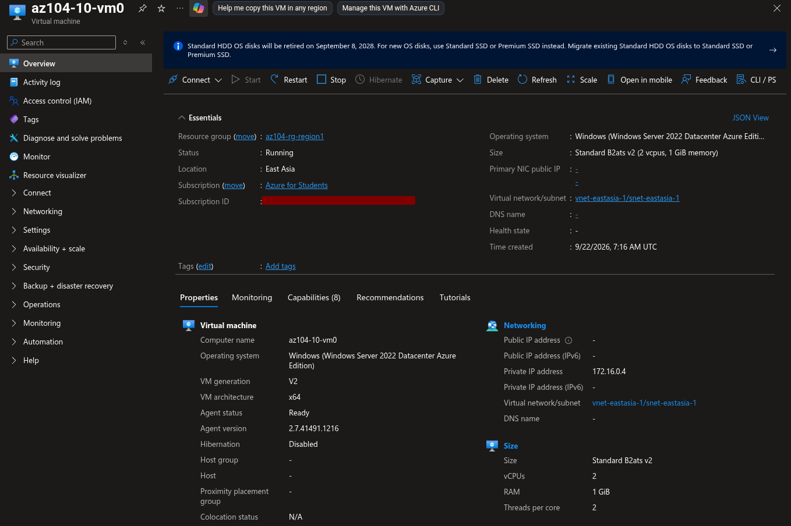
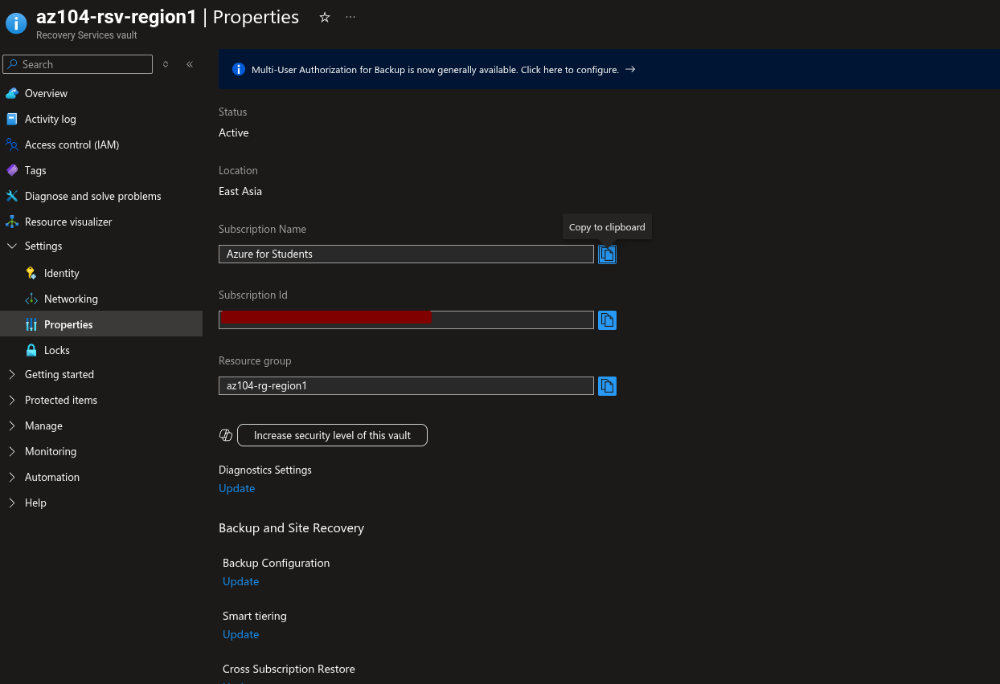
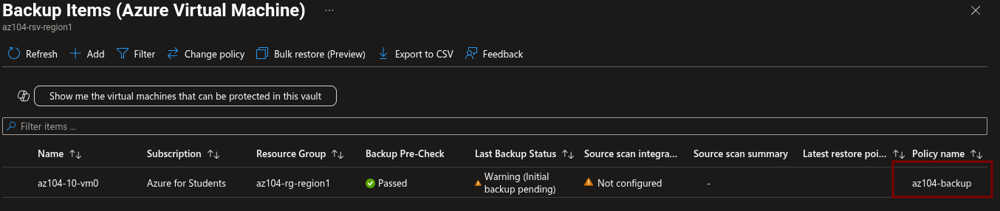
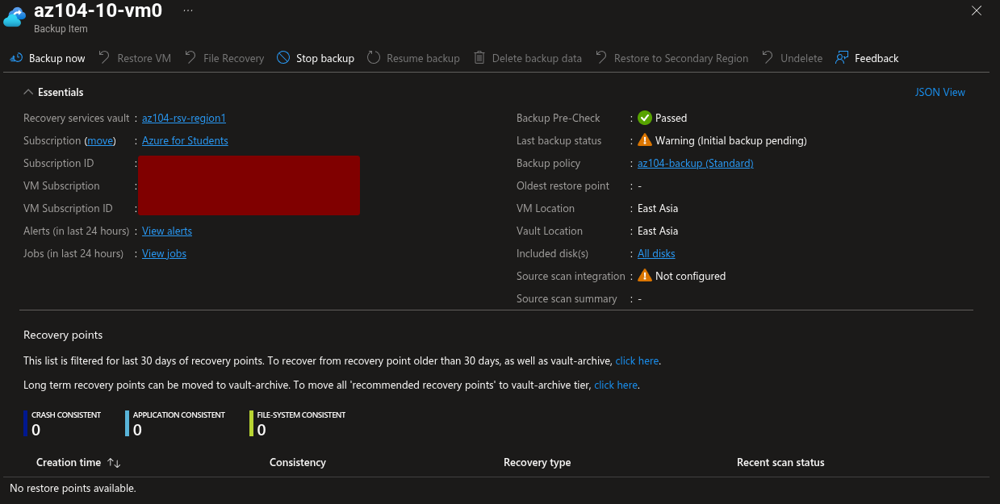
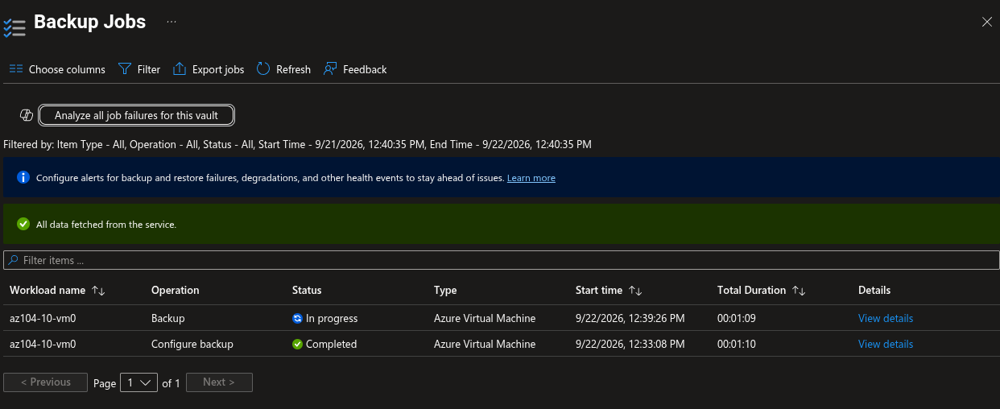
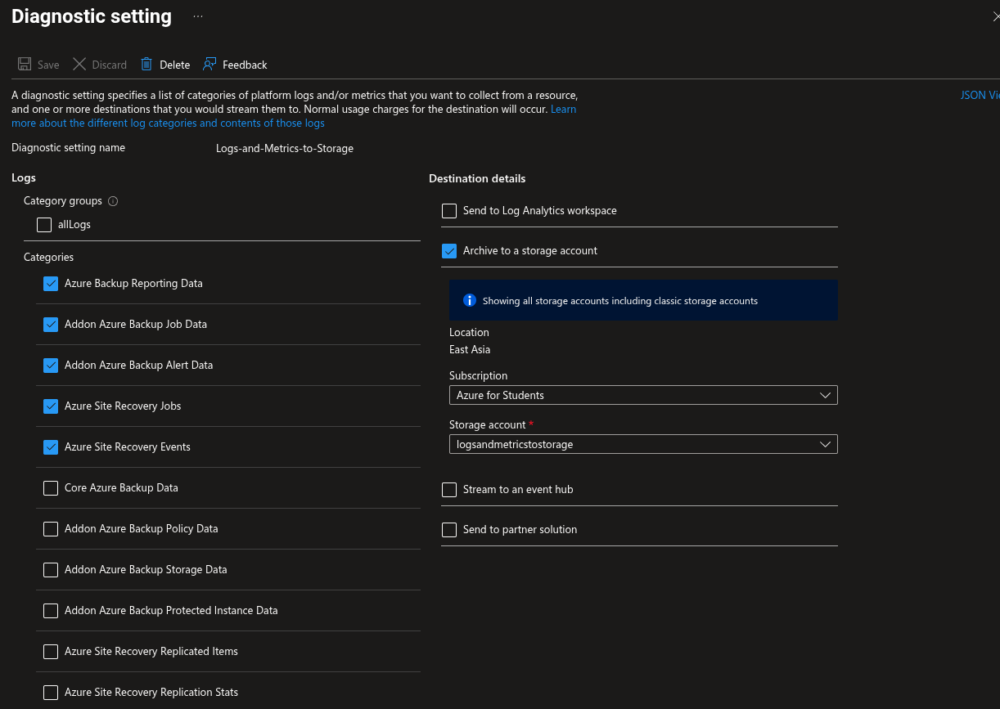
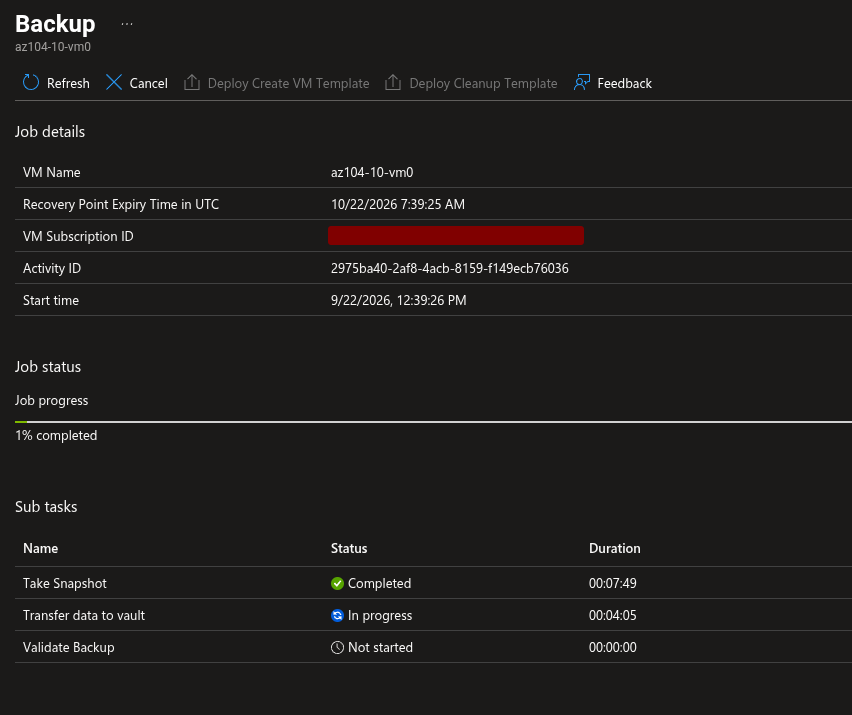
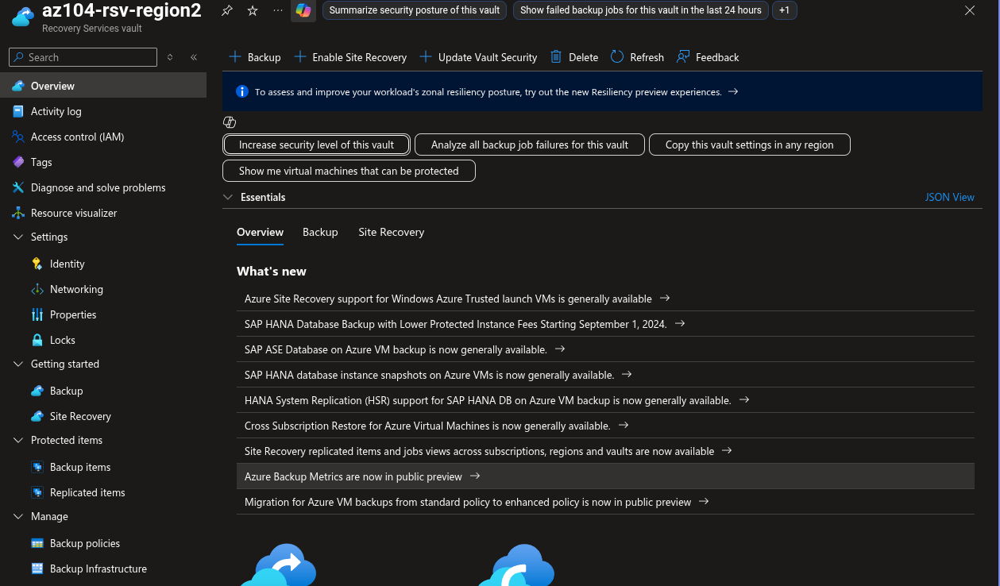
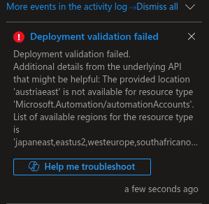
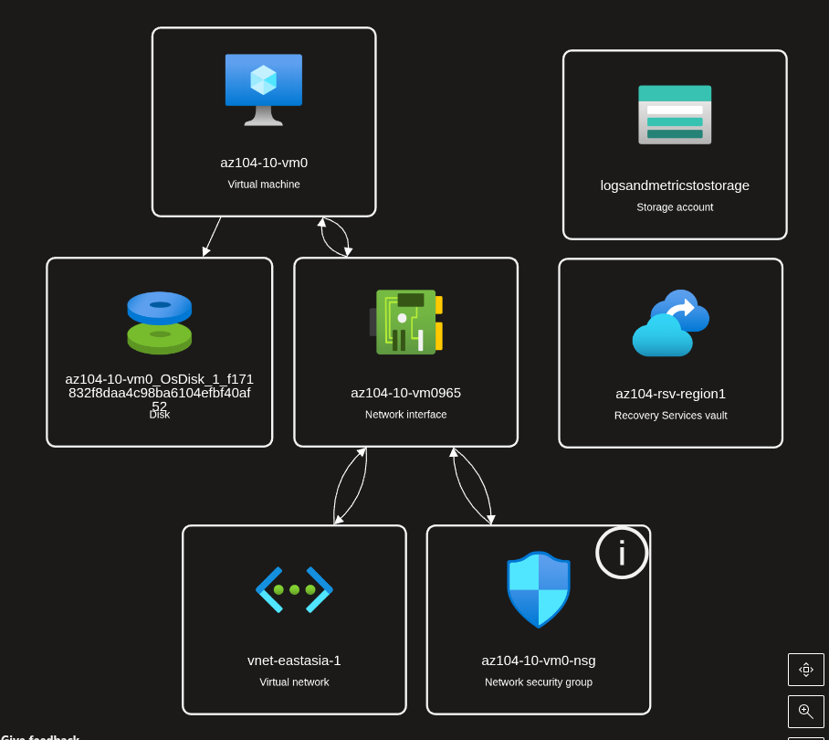

# Lab 10: Implement Azure Data Protection

## Overview

This lab explored Azure Backup and Azure Site Recovery for an Azure virtual machine. The source VM was configured with a low-cost B-series size and Standard HDD storage. A Recovery Services vault was created for backup, a VM backup policy was configured, backup monitoring was reviewed, and Site Recovery replication was attempted.

The backup portion was completed. The Site Recovery portion could not be completed because Azure rejected the required Automation account deployment in the selected region/subscription. The failure was captured as evidence and all lab resource groups were deleted afterward.

## Objectives

- Deploy a source Windows virtual machine.
- Create a Recovery Services vault.
- Review vault redundancy and soft-delete settings.
- Configure an Azure VM backup policy.
- Enable backup protection for the VM.
- Start a backup operation.
- Review backup jobs and diagnostics.
- Create a second Recovery Services vault for disaster recovery.
- Attempt Azure Site Recovery replication.
- Document a regional resource-availability limitation.
- Clean up all temporary resources.

## Architecture

```text
                         Source region
                    East Asia / region 1
                    Resource group: az104-rg-region1
                                  |
                  ┌───────────────┴────────────────┐
                  |                                |
                  v                                v
       Azure VM: az104-10-vm0          Recovery Services vault
       Windows Server                  az104-rsv-region1
       Standard_B2ats_v2               GRS backup storage
       Standard HDD LRS                14-day soft delete
                  |                                |
                  | Azure VM backup                 |
                  └───────────────┬────────────────┘
                                  v
                         Backup policy: az104-backup
                         Daily at 12:00 AM
                         Instant snapshot retention: 2 days
                                  |
                                  v
                           Backup job / recovery point

                  Optional monitoring storage account
                  Diagnostic settings for backup and ASR

                         Target region
                    Resource group: az104-rg-region2
                                  |
                                  v
                    Recovery Services vault
                    az104-rsv-region2
                                  |
                                  v
                  Site Recovery replication attempt
                  Failed during Automation account validation
```

## Resource Inventory

| Resource | Name | Configuration / result |
|---|---|---|
| Source resource group | `az104-rg-region1` | Deleted after evidence capture |
| Source VM | `az104-10-vm0` | Windows Server, B-series, Standard HDD |
| Source vault | `az104-rsv-region1` | GRS, 14-day soft delete |
| Backup policy | `az104-backup` | Daily, 12:00 AM, 2-day snapshot retention |
| Backup monitoring storage | Lab storage account | Created only if required by the diagnostic task |
| Target resource group | `az104-rg-region2` | Deleted after evidence capture |
| Target vault | `az104-rsv-region2` | Created in a different region |
| Site Recovery replication | `az104-10-vm0` | Attempted but validation failed |

## Cost-Optimization Decisions

The official lab specifies a D-series VM and uses multiple backup and disaster-recovery resources. This implementation reduced cost by using:

```text
VM size: Standard_B2ats_v2 where available
OS disk: Standard HDD LRS
Public IP: None
Public inbound ports: None
Boot diagnostics: Disabled
Backup: Enabled only for the exercise
Site Recovery: Attempted only after backup evidence was captured
No test failover
No long-running replication
```

Azure Backup and Site Recovery can create storage and data-transfer charges. Site Recovery can also create replica disks and cache storage even when protected-instance licensing is temporarily free. Resources were deleted immediately after the lab.

## Task 1: Source VM

The source VM was deployed in the source region using a low-cost configuration:

```text
VM name: az104-10-vm0
Operating system: Windows Server
Size: Standard_B2ats_v2
OS disk: Standard HDD LRS
Public IP: None
Public inbound ports: None
```



## Task 2: Recovery Services Vault

The source Recovery Services vault was created in the same region as the source VM:

```text
Vault name: az104-rsv-region1
Region: Source VM region
Backup storage replication: Geo-redundant
Soft-delete retention: 14 days
```



Soft delete protects backup data after deletion by retaining it for an additional recovery period. The default soft-delete period is 14 days.

## Task 3: Azure VM Backup

A Standard VM backup policy was configured:

```text
Policy name: az104-backup
Policy subtype: Standard
Frequency: Daily
Time: 12:00 AM
Timezone: Local timezone
Instant recovery snapshot retention: 2 days
```

The source VM was added to the protected items list and backup was enabled.





A Backup Now operation was started with the default retention value.



## Task 4: Monitor Azure Backup

Diagnostic settings were configured or reviewed for backup and Site Recovery categories:

```text
Azure Backup Reporting Data
Addon Azure Backup Job Data
Addon Azure Backup Alert Data
Azure Site Recovery Jobs
Azure Site Recovery Events
```

Where the diagnostic task was completed, data was archived to the lab storage account.



The Backup Jobs blade was used to locate the operation for `az104-10-vm0` and review its details.



## Task 5: Site Recovery Attempt

A target Recovery Services vault was created in a different region:

```text
Vault name: az104-rsv-region2
Region: Different from the source VM region
```



Replication was then started from:

```text
az104-10-vm0 → Backup + Disaster recovery → Disaster recovery
```

During validation, Azure returned the following failure:

```text
Deployment validation failed.

The provided location 'austriaeast' is not available for resource type
'Microsoft.Automation/automationAccounts'.
```



### Failure Interpretation

This was a regional/subscription resource-availability limitation. The required Automation account could not be created in the selected location. The failure does not prove that the source VM or backup vault was invalid.

The replication workflow was attempted but did not reach a healthy or protected state. No successful replication or failover is claimed.

## Resource Topology

Azure Resource Visualizer was captured before cleanup to document the deployed data-protection resources.



## Completion Status

| Task | Result |
|---|---|
| Task 1: Provision source VM | Completed |
| Task 2: Create Recovery Services vault | Completed |
| Task 3: Configure VM backup | Completed |
| Task 4: Monitor Azure Backup | Completed / reviewed |
| Task 5: Enable Site Recovery replication | Not completed |
| Site Recovery result | Validation failed because Automation was unavailable in the selected location |
| Evidence capture | Completed |
| Cleanup | Completed; resource groups deleted |

## Lessons Learned

- Azure Backup protects VM data through recovery points and retention policies.
- Recovery Services vault redundancy affects where backup data is replicated.
- Soft delete protects backup data after accidental or malicious deletion.
- Backup jobs and diagnostic settings provide operational visibility.
- Site Recovery replication depends on the availability of supporting resource providers in the selected regions.
- A successful vault deployment does not guarantee that every Site Recovery dependency is available in the same subscription or region.
- Regional resource availability must be validated before starting a paid replication workflow.

## Security and Cost Notes

- No public IP was required for the source VM.
- Standard HDD storage was used to reduce cost.
- No test failover was performed.
- Site Recovery was not left running.
- Backup and replication resources were cleaned up after evidence capture.
- No credentials, subscription IDs, or secrets are included in the screenshots or documentation.

## Cleanup

Both lab resource groups were deleted after evidence capture:

```bash
az group delete --name az104-rg-region1 --yes --no-wait
az group delete --name az104-rg-region2 --yes --no-wait
```

Use the exact resource-group names from the Azure portal if they differ from the names above.

## Expected Outcome

The lab successfully demonstrates Azure VM backup configuration, Recovery Services vault settings, backup policy creation, protection status, backup monitoring, and topology documentation. Site Recovery replication was attempted but remained incomplete because the required Automation account resource type was unavailable in the selected region/subscription.
